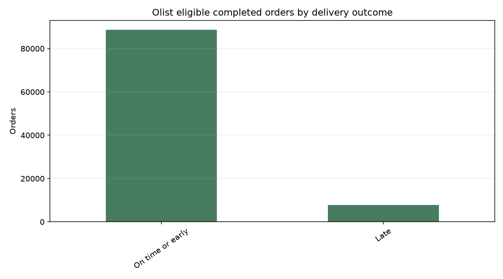
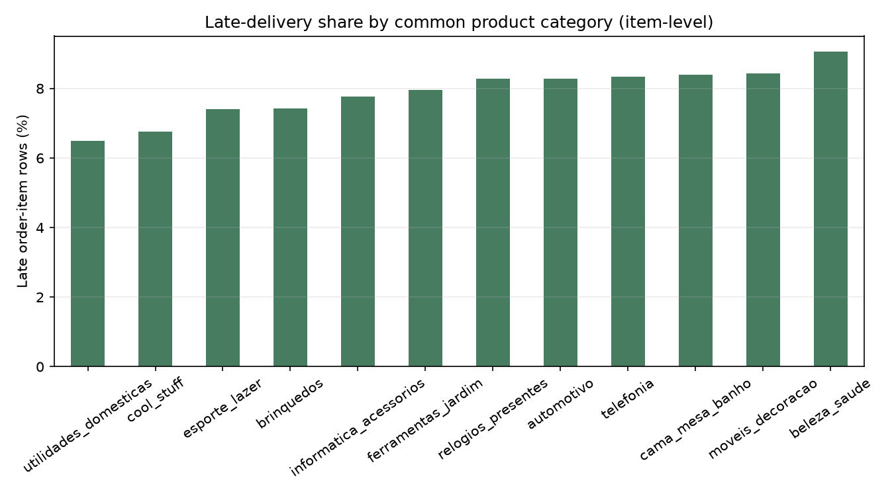
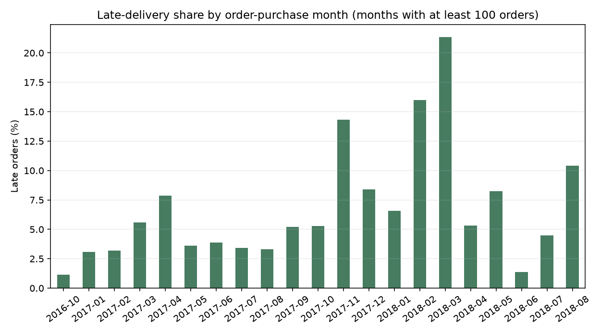
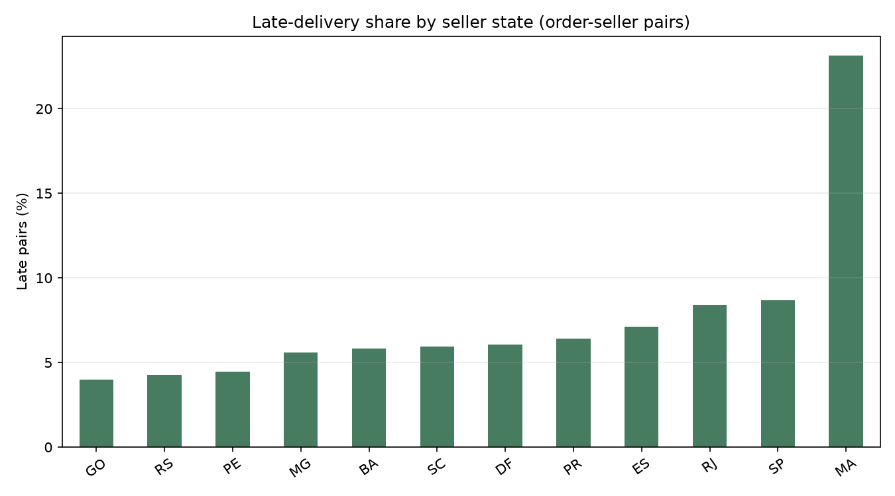

# Olist Dataset Analysis — Phase 1A

**Status:** Measured from the downloaded Kaggle CSV files. No model was trained.

## Source and license

- Source: [Olist Brazilian E-Commerce Public Dataset](https://www.kaggle.com/datasets/olistbr/brazilian-ecommerce)
- License shown on the Kaggle dataset card: CC BY-NC-SA 4.0.
- Use in this project is limited to non-commercial educational analysis; raw data is excluded from Git.
- Original CSVs were only read, not edited. The retained ZIP archive is under the ignored `ml/data/downloads/` directory.

## Files, columns, types, and quality

The exact counts below come from `ml/reports/dataset_inspection.json`, generated from the downloaded files. Dtypes are pandas' inferred read-time types, not validated business types.

| File | Rows | Columns | Exact duplicate rows | Rows with duplicate checked key |
|---|---:|---:|---:|---:|
| `olist_customers_dataset.csv` | 99,441 | 5 | 0 | 0 |
| `olist_geolocation_dataset.csv` | 1,000,163 | 5 | 261,831 | Not checked |
| `olist_order_items_dataset.csv` | 112,650 | 7 | 0 | 0 |
| `olist_order_payments_dataset.csv` | 103,886 | 5 | 0 | 0 |
| `olist_order_reviews_dataset.csv` | 99,224 | 7 | 0 | 1,603 |
| `olist_orders_dataset.csv` | 99,441 | 8 | 0 | 0 |
| `olist_products_dataset.csv` | 32,951 | 9 | 0 | 0 |
| `olist_sellers_dataset.csv` | 3,095 | 4 | 0 | 0 |
| `product_category_name_translation.csv` | 71 | 2 | 0 | Not checked |

### Columns and inferred pandas dtypes

#### `olist_customers_dataset.csv`

| Column | Inferred dtype | Missing |
|---|---|---:|
| `customer_id` | `str` | 0 |
| `customer_unique_id` | `str` | 0 |
| `customer_zip_code_prefix` | `int64` | 0 |
| `customer_city` | `str` | 0 |
| `customer_state` | `str` | 0 |

#### `olist_geolocation_dataset.csv`

| Column | Inferred dtype | Missing |
|---|---|---:|
| `geolocation_zip_code_prefix` | `int64` | 0 |
| `geolocation_lat` | `float64` | 0 |
| `geolocation_lng` | `float64` | 0 |
| `geolocation_city` | `str` | 0 |
| `geolocation_state` | `str` | 0 |

#### `olist_order_items_dataset.csv`

| Column | Inferred dtype | Missing |
|---|---|---:|
| `order_id` | `str` | 0 |
| `order_item_id` | `int64` | 0 |
| `product_id` | `str` | 0 |
| `seller_id` | `str` | 0 |
| `shipping_limit_date` | `str` | 0 |
| `price` | `float64` | 0 |
| `freight_value` | `float64` | 0 |

#### `olist_order_payments_dataset.csv`

| Column | Inferred dtype | Missing |
|---|---|---:|
| `order_id` | `str` | 0 |
| `payment_sequential` | `int64` | 0 |
| `payment_type` | `str` | 0 |
| `payment_installments` | `int64` | 0 |
| `payment_value` | `float64` | 0 |

#### `olist_order_reviews_dataset.csv`

| Column | Inferred dtype | Missing |
|---|---|---:|
| `review_id` | `str` | 0 |
| `order_id` | `str` | 0 |
| `review_score` | `int64` | 0 |
| `review_comment_title` | `str` | 87,656 |
| `review_comment_message` | `str` | 58,247 |
| `review_creation_date` | `str` | 0 |
| `review_answer_timestamp` | `str` | 0 |

#### `olist_orders_dataset.csv`

| Column | Inferred dtype | Missing |
|---|---|---:|
| `order_id` | `str` | 0 |
| `customer_id` | `str` | 0 |
| `order_status` | `str` | 0 |
| `order_purchase_timestamp` | `str` | 0 |
| `order_approved_at` | `str` | 160 |
| `order_delivered_carrier_date` | `str` | 1,783 |
| `order_delivered_customer_date` | `str` | 2,965 |
| `order_estimated_delivery_date` | `str` | 0 |

#### `olist_products_dataset.csv`

| Column | Inferred dtype | Missing |
|---|---|---:|
| `product_id` | `str` | 0 |
| `product_category_name` | `str` | 610 |
| `product_name_lenght` | `float64` | 610 |
| `product_description_lenght` | `float64` | 610 |
| `product_photos_qty` | `float64` | 610 |
| `product_weight_g` | `float64` | 2 |
| `product_length_cm` | `float64` | 2 |
| `product_height_cm` | `float64` | 2 |
| `product_width_cm` | `float64` | 2 |

#### `olist_sellers_dataset.csv`

| Column | Inferred dtype | Missing |
|---|---|---:|
| `seller_id` | `str` | 0 |
| `seller_zip_code_prefix` | `int64` | 0 |
| `seller_city` | `str` | 0 |
| `seller_state` | `str` | 0 |

#### `product_category_name_translation.csv`

| Column | Inferred dtype | Missing |
|---|---|---:|
| `product_category_name` | `str` | 0 |
| `product_category_name_english` | `str` | 0 |

### Relationships

Orphan counts below compare non-null child references to values in the referenced parent column. Geolocation is keyed by ZIP prefix for this check; it is not a one-row-per-prefix table.

| Child reference | Parent key | Non-null child rows | Orphan rows |
|---|---|---:|---:|
| `olist_order_items_dataset.csv.order_id` | `olist_orders_dataset.csv.order_id` | 112,650 | 0 |
| `olist_order_items_dataset.csv.product_id` | `olist_products_dataset.csv.product_id` | 112,650 | 0 |
| `olist_order_items_dataset.csv.seller_id` | `olist_sellers_dataset.csv.seller_id` | 112,650 | 0 |
| `olist_order_payments_dataset.csv.order_id` | `olist_orders_dataset.csv.order_id` | 103,886 | 0 |
| `olist_order_reviews_dataset.csv.order_id` | `olist_orders_dataset.csv.order_id` | 99,224 | 0 |
| `olist_orders_dataset.csv.customer_id` | `olist_customers_dataset.csv.customer_id` | 99,441 | 0 |
| `olist_customers_dataset.csv.customer_zip_code_prefix` | `olist_geolocation_dataset.csv.geolocation_zip_code_prefix` | 99,441 | 278 |
| `olist_sellers_dataset.csv.seller_zip_code_prefix` | `olist_geolocation_dataset.csv.geolocation_zip_code_prefix` | 3,095 | 7 |

## Prediction target and eligible population

Definition: `late_delivery = actual customer delivery timestamp > estimated delivery timestamp`.

Eligibility rule: order_status == delivered and order_id, actual customer delivery timestamp, and estimated delivery timestamp are valid.

| Population/exclusion | Count |
|---|---:|
| All order rows | 99,441 |
| Not marked `delivered` | 2,963 |
| Delivered status with missing/invalid actual delivery timestamp | 8 |
| Delivered status with actual but missing/invalid estimated timestamp | 0 |
| Delivered status with missing order ID | 0 |
| Eligible completed orders | 96,470 |

The target is `1` only when the actual customer delivery timestamp is strictly later than the estimated timestamp; orders delivered on or before the estimate are `0`. These are historical labels, not real-time model outputs.

## Late vs on-time/early and class balance

- Late: 7,826 (8.11%).
- On time or early: 88,644 (91.89%).
- Mean delivery minus estimate: -11.18 days (about 11.18 days before the estimate on average).
- Median delivery minus estimate: -11.95 days.

A majority-only guess would label every eligible order on-time/early and match 91.89% of historical labels, while missing all 7,826 late orders. This shows why accuracy alone can hide poor late-order detection. This is a prevalence calculation, not model performance; no model was fit.

## Beginner-friendly findings and data-quality cautions

- Eligible completed orders cover purchase timestamps from `2016-09-15T12:16:38+00:00` to `2018-08-29T15:00:37+00:00`.
- Late delivery is the minority outcome (8.11%), so later evaluation should examine late-class recall and precision alongside overall accuracy.
- The geolocation table has exact repeated rows. It is a many-rows-per-ZIP-prefix lookup, so do not join it directly to orders without a documented aggregation rule.
- The review table has 1,603 rows with duplicated `review_id` values across 789 repeated IDs; none of these are exact duplicate full rows. Do not assume `review_id` uniquely identifies a review row.
- There are 278 customer ZIP-prefix references and 7 seller ZIP-prefix references with no match in the geolocation lookup.
- Some product fields and review comments are missing; per-column counts are shown above. Reviews and review timestamps are post-outcome and must not be model predictors.

## EDA figures

These figures show descriptive associations only, not causes or future model performance. The monthly chart omits months with fewer than 100 eligible orders; category and seller-state charts also require at least 100 rows.

- 
- 
- 
- 

## Candidate features at order purchase time

These are candidate fields for later review, not a final approved model schema. Only values available at the chosen scoring instant should be retained.

| Candidate | Purpose | Availability / caution |
|---|---|---|
| Purchase date/time parts | Capture seasonality and day-of-week patterns | Available at purchase; timezone is not explicitly documented in the raw data. |
| Promised lead time (`estimated date - purchase timestamp`) | Represent the promise horizon | Use only if the estimated date is fixed and available at prediction time. |
| Product category, item count, product dimensions | Describe order composition | Available from the catalog/order at purchase; review missing category/dimensions. |
| Order item price and freight, aggregated per order | Describe order scale/logistics charge | Confirm these values are known at the intended scoring time. |
| Seller count; coarse seller/customer state or lane | Represent fulfillment/geographic context | Avoid raw identifiers and detailed personal location; account for sparse categories. |

Exclude actual customer/carrier delivery timestamps, review content/scores/timestamps, terminal order status, and raw customer/order/seller/product identifiers from predictor features. Actual and estimated delivery timestamps are used to construct the historical target only, except a separately engineered promised-lead-time feature if approved.

## Key limitations and data-quality notes

- Olist represents Brazilian e-commerce orders from 2016–2018, not SupplyShield port-to-port shipments.
- It records delivery outcome, but not internal disruption causes such as weather, port closure, fuel shocks, or geopolitical events.
- Orders contain multiple item, seller, and payment rows. Any later train/validation/test split must group by `order_id` to prevent the same order from crossing partitions.
- Inferred numeric dtypes do not make identifiers or ZIP prefixes quantitative measures; cast identifiers/categories deliberately in any later pipeline.
- License is non-commercial/share-alike. This dataset is for educational work only unless separate rights are obtained.

## Reproducibility

From the repository root run `python ml/scripts/inspect_dataset.py` followed by `python ml/scripts/analyze_olist.py`. The scripts write measured JSON summaries and PNG charts under `ml/reports/`; they do not modify raw CSVs or train a model.
