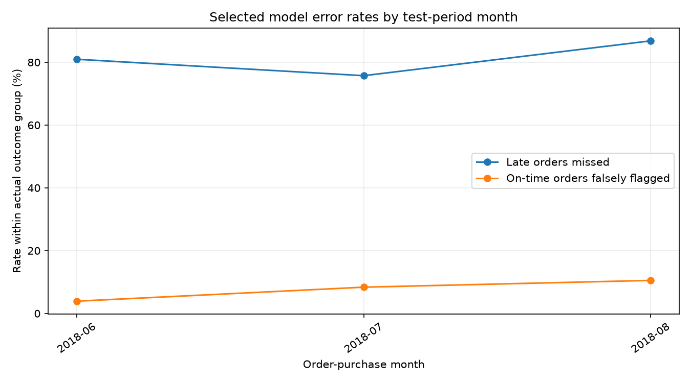

# Olist Model Error Review — Phase 1B

**Scope:** Read-only analysis of the already trained, selected Logistic Regression model on the untouched chronological test period. No model was retrained and no threshold was changed.

## Overall errors

At the validation-selected threshold `0.5049`, the model flagged 1,325 of 14,471 test orders as late.

| Outcome | Count | Meaning |
|---|---:|---|
| True positive | 158 | Late orders correctly flagged |
| False negative | 799 | Late orders missed |
| False positive | 1,167 | On-time/early orders incorrectly flagged |
| True negative | 12,347 | On-time/early orders correctly left unflagged |

The model missed 83.49% of test late orders and incorrectly flagged 8.64% of test on-time/early orders. Of all flagged orders, 88.08% were false alerts. These are measured on one historical holdout only.

## Error rates by purchase month

These are descriptive rates, with counts shown so small samples can be identified. The test period contains only later 2018 purchases.

| Month | Test orders | Actual late | Late missed | Miss rate among late | On-time/early | False alerts | False-alert rate among on-time |
|---|---:|---:|---:|---:|---:|---:|---:|
| 2018-06 | 1,964 | 21 | 17 | 80.95% | 1,943 | 76 | 3.91% |
| 2018-07 | 6,156 | 276 | 209 | 75.72% | 5,880 | 492 | 8.37% |
| 2018-08 | 6,351 | 660 | 573 | 86.82% | 5,691 | 599 | 10.53% |

## Possible temporal shift in a high-error group

The selected Logistic Regression model assigns a negative conditional coefficient to `customer_state_SP`. The observed late-order share in that customer-state group changed across the chronological partitions, and the model missed most of its test late orders. This is a useful drift signal to investigate, not proof that geography caused errors.

| Partition | Customer-state SP orders | Late orders | Late share |
|---|---:|---:|---:|
| Train | 27,204 | 1,522 | 5.59% |
| Validation | 6,540 | 222 | 3.39% |
| Test | 6,750 | 643 | 9.53% |

In the test partition, 633 of 643 late orders with customer state SP were missed. The fitted conditional coefficient for this one-hot feature was `-1.437`; the standardized promised-lead-days coefficient was `-0.551`. Coefficient signs describe the model's learned association after controlling for its other inputs; they do not show causes.

## Product category groups

Only groups with at least 100 actual late orders are ranked for missed-late rates; false-alert comparisons also require at least 100 actual on-time/early orders. These comparisons are descriptive and not causal.

### Highest missed-late rates among adequately sized groups

| Group | Actual late orders | Missed | Miss rate | Actual on-time/early | False alerts | False-alert rate |
|---|---:|---:|---:|---:|---:|---:|
| health_beauty | 152 | 118 | 77.63% | 1,571 | 171 | 10.88% |

### Highest false-alert rates among adequately sized groups

| Group | Actual on-time/early orders | False alerts | False-alert rate | Actual late orders | Missed | Miss rate |
|---|---:|---:|---:|---:|---:|---:|
| baby | 428 | 70 | 16.36% | 36 | 26 | n/a |
| construction_tools_construction | 241 | 37 | 15.35% | 21 | 20 | n/a |
| bed_bath_table | 1,185 | 142 | 11.98% | 63 | 44 | n/a |
| perfumery | 378 | 42 | 11.11% | 20 | 19 | n/a |
| health_beauty | 1,571 | 171 | 10.88% | 152 | 118 | 77.63% |
| furniture_decor | 742 | 78 | 10.51% | 43 | 32 | n/a |
| auto | 716 | 69 | 9.64% | 51 | 46 | n/a |
| garden_tools | 307 | 26 | 8.47% | 11 | 10 | n/a |

## Customer state groups

Only groups with at least 100 actual late orders are ranked for missed-late rates; false-alert comparisons also require at least 100 actual on-time/early orders. These comparisons are descriptive and not causal.

### Highest missed-late rates among adequately sized groups

| Group | Actual late orders | Missed | Miss rate | Actual on-time/early | False alerts | False-alert rate |
|---|---:|---:|---:|---:|---:|---:|
| SP | 643 | 633 | 98.44% | 6,107 | 19 | 0.31% |

### Highest false-alert rates among adequately sized groups

| Group | Actual on-time/early orders | False alerts | False-alert rate | Actual late orders | Missed | Miss rate |
|---|---:|---:|---:|---:|---:|---:|
| CE | 166 | 66 | 39.76% | 2 | 0 | n/a |
| PA | 111 | 40 | 36.04% | 3 | 2 | n/a |
| BA | 436 | 138 | 31.65% | 22 | 9 | n/a |
| PE | 229 | 71 | 31.00% | 12 | 7 | n/a |
| RJ | 1,537 | 449 | 29.21% | 88 | 20 | n/a |
| SC | 446 | 70 | 15.70% | 16 | 9 | n/a |
| ES | 259 | 37 | 14.29% | 13 | 9 | n/a |
| RS | 696 | 44 | 6.32% | 24 | 17 | n/a |

## Seller state groups

Only groups with at least 100 actual late orders are ranked for missed-late rates; false-alert comparisons also require at least 100 actual on-time/early orders. These comparisons are descriptive and not causal.

### Highest missed-late rates among adequately sized groups

| Group | Actual late orders | Missed | Miss rate | Actual on-time/early | False alerts | False-alert rate |
|---|---:|---:|---:|---:|---:|---:|
| SP | 738 | 664 | 89.97% | 9,284 | 763 | 8.22% |

### Highest false-alert rates among adequately sized groups

| Group | Actual on-time/early orders | False alerts | False-alert rate | Actual late orders | Missed | Miss rate |
|---|---:|---:|---:|---:|---:|---:|
| MA | 132 | 55 | 41.67% | 32 | 11 | n/a |
| RJ | 693 | 153 | 22.08% | 53 | 13 | n/a |
| BA | 108 | 16 | 14.81% | 6 | 4 | n/a |
| SC | 497 | 50 | 10.06% | 27 | 18 | n/a |
| SP | 9,284 | 763 | 8.22% | 738 | 664 | 89.97% |
| MG | 988 | 56 | 5.67% | 22 | 19 | n/a |
| DF | 111 | 5 | 4.50% | 8 | 8 | n/a |
| PR | 1,101 | 43 | 3.91% | 37 | 32 | n/a |

## Numeric feature patterns in errors

Median values are compared between missed and caught late orders, and between false alerts and correctly unflagged on-time/early orders. These are post hoc descriptions of this test sample; they do not establish that a feature caused an error.

| Feature | Late caught median (n) | Late missed median (n) | On-time correctly unflagged median (n) | False-alert median (n) |
|---|---:|---:|---:|---:|
| `promised_lead_days` | 13.198 (n=158) | 7.325 (n=799) | 18.319 (n=12,347) | 18.120 (n=1,167) |
| `item_count` | 1.000 (n=158) | 1.000 (n=799) | 1.000 (n=12,347) | 1.000 (n=1,167) |
| `seller_count` | 1.000 (n=158) | 1.000 (n=799) | 1.000 (n=12,347) | 1.000 (n=1,167) |
| `item_price_total` | 109.450 (n=158) | 77.900 (n=799) | 79.990 (n=12,347) | 118.800 (n=1,167) |
| `freight_total` | 23.180 (n=158) | 13.420 (n=799) | 18.480 (n=12,347) | 24.540 (n=1,167) |
| `mean_product_weight_g` | 787.500 (n=158) | 525.000 (n=799) | 550.000 (n=12,347) | 975.000 (n=1,167) |
| `mean_product_length_cm` | 25.000 (n=158) | 21.000 (n=799) | 22.000 (n=12,347) | 30.000 (n=1,167) |
| `mean_product_height_cm` | 12.000 (n=158) | 12.000 (n=799) | 12.500 (n=12,347) | 14.000 (n=1,167) |
| `mean_product_width_cm` | 20.000 (n=158) | 17.000 (n=799) | 19.000 (n=12,347) | 20.000 (n=1,167) |

## What this suggests for the next iteration

- The operating threshold was chosen for F1, not for an agreed business alert budget. Any threshold change must use validation data and a stated missed-delay versus false-alert trade-off; do not tune on this test period.
- Error rates vary with the late-order prevalence in each time slice and subgroup. Review the denominators and do not interpret small or historical groups as stable risk estimates.
- Investigate whether the Olist ETA and shipment timing fields are truly available at the intended prediction instant. If not, remove the affected features and retrain on a fresh validation/test design.
- The model still misses many late orders and generates many false alerts. It should remain an educational benchmark, not a dashboard or operational predictor.
- Use a future improvement cycle to inspect label quality, temporal drift, sparse categories, and additional legitimate early-warning signals. New datasets/features require separate provenance and leakage review.

No order IDs, customer IDs, or raw customer records are included in this report.
