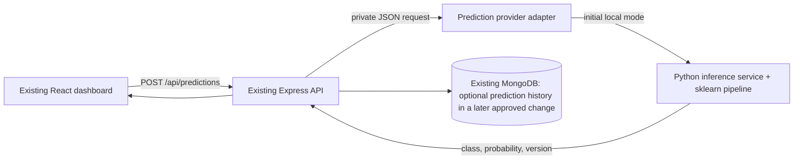

# SupplyShield ML Implementation Plan

**Status:** Phase 1A and 1B are complete. Test error review and a validation-only feature sensitivity review are documented in [`ML_ERROR_ANALYSIS.md`](ML_ERROR_ANALYSIS.md) and [`ML_FEATURE_REVIEW.md`](ML_FEATURE_REVIEW.md). The selected local benchmark artifact remains disconnected from the application. No React, Express, MongoDB, or SAP integration has been implemented.  
**Scope:** Build an educational, explainable first model for predicting late delivery. This is a narrow first step toward disruption detection; a late-delivery classifier does not predict every supply-chain disruption (for example, port closure, supplier insolvency, weather events, loss, or geopolitical risk).

## 1. Current state and design constraints

The repository currently contains a React 18 / TypeScript / Vite dashboard, a Node.js / Express API, and MongoDB through Mongoose. The current `Shipment` document has `id`, `supplier`, free-text `route`, `carrier`, `eta`, `status`, and a manually entered `risk` value. The UI explicitly says that risk values are manually entered and that no prediction model is connected.

The raw benchmark data and trained artifact are kept locally and excluded from Git. The repository now contains a pinned Python dependency list, data inspection/EDA scripts, and a standalone scikit-learn training script. The Phase 1B pipeline compares a majority baseline, Logistic Regression, a shallow Decision Tree, and Random Forest with a time-based holdout; its evaluation is documented in [`ML_TRAINING_REPORT.md`](ML_TRAINING_REPORT.md). No inference endpoint, prediction-history collection, or app integration exists. The existing Node application remains the system of record and UI/API boundary; later inference would require a separately designed Python service behind Express.

**Important mismatch:** DataCo and Olist are order/retail fulfillment datasets, while SupplyShield currently displays generic shipments. The first model would be a benchmark for late-delivery risk using a selected public dataset. It must not silently score existing user shipments until a deliberate field mapping and sufficient real shipment features are available. Existing `risk` values must remain separate from model predictions.

## 2. Public dataset candidates and selection

| Candidate | What the source describes | Fit and caveats |
|---|---|---|
| **Brazilian E-Commerce Public Dataset by Olist (approved first benchmark)** | The Kaggle release contains order status/timestamps, customer/seller location, products, freight, and estimated and actual customer-delivery dates. The dataset card lists **CC BY-NC-SA 4.0**. Phase 1A confirmed 99,441 order rows in the orders file and 9 CSV files total. | `late_delivery` can be derived from delivered orders with valid timestamps. The benchmark predicts historical e-commerce lateness, not all supply-chain disruption and not port-level freight events. Its non-commercial/share-alike license limits use to non-commercial educational work unless rights are separately reviewed. Measured schema and limitations are in [`DATASET_ANALYSIS.md`](DATASET_ANALYSIS.md). |
| **DataCo SMART SUPPLY CHAIN FOR BIG DATA ANALYSIS (alternative, not selected)** | Original Mendeley Data release by Constante, Silva, and Pereira, version 5, DOI `10.17632/8gx2fvg2k6.5`; it provides a structured supply-chain CSV plus a variable description file and lists a **CC BY 4.0** license. | Broader supply-chain framing, but its target semantics and leakage fields require careful verification. It was not selected for the first benchmark. Reconsider only as a separate future dataset review. |

### Selection

Use the **Olist Brazilian E-Commerce Public Dataset** as the approved first educational benchmark. The Phase 1A files have been downloaded to the ignored `ml/data/raw/` folder, inspected, and summarized in [`DATASET_ANALYSIS.md`](DATASET_ANALYSIS.md). The exact educational target is actual customer delivery later than estimated delivery, among eligible delivered orders. This is not a general supply-chain disruption label. The license is CC BY-NC-SA 4.0 and the current use is non-commercial education only.

The first implementation should stop before training if the data dictionary cannot establish a defensible prediction-time label and predictors. Do not use benchmark accuracy as a claim about SupplyShield’s real-world predictive ability. Obtain future consented operational shipment history and a domain-approved disruption definition before production claims or operational use.

## 3. Target and prediction point

### Initial target

Start with a binary **late-delivery outcome** target only after verifying the source definition:

- `1` = a shipment/order met the dataset’s documented late-delivery condition.
- `0` = it did not.

Document the source column or exact derivation, row granularity (order vs order line), positive-class meaning, and any exclusions. Do not infer disruption from an entered SupplyShield risk score. If a supplied `Late_delivery_risk` column is used as the label, audit its meaning against the source documentation and compare it with realized outcome columns. Keep the target out of the predictor matrix.

### Prediction point

Define a realistic point in time, such as **when an order/shipment is created or confirmed**. For every feature, write down whether that value would actually be known at that point. Since the public dataset’s recorded time fields may not correspond to a live dispatch-time snapshot, document any proxy/limitation. If a feature is only known after shipment or delivery, exclude it even if it improves offline metrics.

## 4. Feature plan

Feature names below are candidate concepts informed by the observed Olist schema. They remain subject to prediction-time checks before training; the data analysis documents the columns and leakage cautions.

| Feature group | Candidate features available before outcome | Notes |
|---|---|---|
| Timing | order/creation timestamp transformed to month, day-of-week, hour/season where meaningful; planned delivery duration if known | Convert dates consistently; avoid actual dispatch/delivery timestamps if not known at prediction time. |
| Service / transport | shipping mode or service class; planned transit duration | Confirm that service choice is known at scoring time. |
| Order / product | item count/quantity, product category, product weight/dimensions if known, order value if known | Aggregate item-level rows carefully and only use information available at prediction time. |
| Geography | origin/destination market, region, state/city category, route/lane category | Prefer coarse categories over customer identity or precise personal location. Current SupplyShield `route` is free text and cannot be assumed to map to dataset lanes. |
| Supplier / carrier | supplier, seller, or carrier category only if available before prediction and enough history supports it | Do not use raw IDs as arbitrary memorization keys. Historical reliability rates require time-bounded calculations from prior records only. |
| Contextual signals (later) | weather, fuel, port, geopolitical, traffic or disruption indicators with source/time metadata | Not established in this public benchmark or current application schema. Add only with validated, timestamped sources and known scales. |

### Exclude from predictors

- Target column and any duplicate/derived target such as `late_delivery_risk` if it is being used as a feature, delivery-status text, actual days to ship/deliver, actual delivery date, post-delivery review, refund/claim, or any field populated after the chosen prediction time.
- Direct identifiers and personal data: names, email, address, phone, payment/security fields, raw customer IDs, and raw shipment/order IDs. Keep a stable source row/group key outside the model matrix only for joins and split grouping.
- Manually entered SupplyShield `risk` values; they are not labels or model-generated data.

## 5. Data preparation and preprocessing

1. **Download and document.** Olist Phase 1A download and source/license record are complete. Preserve raw data outside Git, and keep the source, license, row/column counts, and schema inventory documented in `DATASET_ANALYSIS.md`.
2. **Inspect before modeling.** Read the data dictionary, identify the row grain, schema, missingness, duplicates, date range, unique categories, class balance, outcome definition, and fields that may contain personal or sensitive information. Create a data-quality summary.
3. **Define label and point in time.** Write a short label specification with positive class, horizon, row grain, eligibility rules, and timestamp of prediction. Reject ambiguous examples rather than silently relabeling them.
4. **Remove leakage and unsafe columns.** Build an explicit allow-list of predictors available at the prediction point. Keep outcome columns in a separate label/validation table and keep identifiers only for deduplication/grouped splitting.
5. **Split before fitting transforms.** Use chronological train/validation/test partitions when reliable timestamps exist, grouping order-level rows together. A proposed starting split is earlier 70% train, next 15% validation, latest 15% test by time, with group boundary checks. If chronology or sample size makes this invalid, document the limitation and use a fixed-seed stratified split grouped by order. Do not randomly scatter rows from the same order across partitions.
6. **Fit preprocessing on training only.** Numeric fields: training-fold median imputation and scaling for Logistic Regression. Categorical fields: explicit unknown/missing handling and one-hot encoding with unseen-category support. Apply the fitted transformer unchanged to validation, test, and live inference. Never fit encoders/imputers on all data before splitting.
7. **Address imbalance carefully.** Report prevalence first. Begin with class-weighted Logistic Regression and class-weighted Random Forest. If resampling is later considered, do it only inside training folds; never alter validation/test class balance.
8. **Save reproducibility metadata.** Store feature allow-list/order, preprocessing pipeline, label mapping, dataset version/hash, split dates/groups, random seed, package versions, model version, and metrics alongside the model artifact. Reject inference requests missing required fields; report degraded/missing-data status rather than silently converting missing inputs to low risk.

## 6. Beginner-friendly models

Build models in this order:

1. **Dummy baseline:** majority-class prediction. This checks whether a model does better than always predicting the most common outcome.
2. **Logistic Regression:** first real model; a useful baseline for binary classification and comparatively easy to explain. Use a scikit-learn `Pipeline`/`ColumnTransformer` so preprocessing and classifier are one saved unit. It can provide probabilities, but those probabilities still need evaluation/calibration.
3. **Decision Tree (optional teaching comparison):** shallow, readable decision rules; can overfit, so cap depth and compare consistently.
4. **Random Forest:** the second required model in `spec.md`; compare its held-out performance and complexity with Logistic Regression. Do not add XGBoost/deep learning until there is a measured reason.

The model choice should follow the documented selection rule, not whichever score looks highest. As proposed in `spec.md`, prioritize positive-class F1, then recall, then precision, while reviewing false negatives and false positives with a human. A threshold is chosen on validation data and frozen before the final test. Never claim a particular expected accuracy or probability quality before running evaluation.

## 7. Evaluation and validation strategy

- **Temporal holdout:** fit using earlier records, tune/choose threshold on a later validation window, and report final results once on the latest untouched test window. Keep all rows for one order in one partition. This better approximates future shipments than a shuffled row split.
- **Metrics:** positive-class precision, recall, F1; confusion matrix; class prevalence; accuracy as a secondary context metric; PR-AUC for an imbalanced positive class; ROC-AUC where both classes are represented; and calibration/Brier score if the dashboard will show probabilities as confidence-like numbers.
- **Why:** recall describes missed late shipments, precision describes how many alerts are correct, F1 summarizes that trade-off, and PR-AUC is informative when positives are relatively rare. Accuracy alone can look high while missing disruptions.
- **Threshold:** choose only on validation data to reflect an agreed review capacity/cost of missed delays vs unnecessary alerts. Do not tune on test data.
- **Leakage checks:** verify no actual outcome fields, post-event records, duplicate order leakage, or target-equivalent features are present; compare a minimal predictor set against candidate additions.
- **Stability checks:** report performance across time windows and adequately sized service/region categories. Mark low-sample groups as inconclusive; do not present subgroup rates as reliable when counts are small.
- **Acceptance:** no performance gate is invented here. Agree a minimum recall/precision or alert-volume target after the initial baseline and business review. If it does not meet the agreed bar or source quality is weak, mark the model experimental and keep it off the operational decision path.
- **Human review:** inspect false negatives/positives and representative cases with a supply-chain reviewer. ML output is decision support, never an automatic supplier, route, or shipment action.

## 8. Connection to the existing Node.js/Express backend

### Planned service boundary

Keep Express as the public API and security boundary. Add a separate Python ML service (for training and local inference) that loads one versioned scikit-learn pipeline. Express calls it over a private/local HTTP connection through a small prediction-provider adapter. The React client never contacts the Python service directly and never receives credentials.



This adds an ML service but does not replace React, Express, or MongoDB. It does require a multi-process development/deployment setup; the current `render.yaml` describes only the Node app. A later implementation must add a separate managed service or another approved hosting arrangement and keep its endpoint private. Do not put an HTTP request to `localhost` into the deployed Render service unless both processes are deliberately colocated and configured.

### Planned request/response contract (illustrative, not implemented)

```json
{
  "shipment_id": "existing-or-imported-id",
  "features": {
    "shipping_mode": "verified-source-value",
    "order_created_at": "2026-01-15T10:00:00Z"
  }
}
```

```json
{
  "shipment_id": "existing-or-imported-id",
  "outcome": "late_delivery",
  "risk_probability": null,
  "model_version": "recorded-version",
  "prediction_source": "LOCAL_ML",
  "predicted_at": "server-generated-timestamp",
  "status": "MODEL_UNAVAILABLE"
}
```

These shapes are design examples only. The final feature schema and response fields depend on the approved dataset/target and trained model. `risk_probability` should be populated only if the selected model exposes a probability and calibration/meaning are documented; values are not measured disruption certainty. A successful response must carry a distinct model status. Model service timeout, validation failure, or unavailable model must yield an explicit unavailable state and preserve the existing dashboard behavior. Do not convert manual `risk` to probability.

Initially return predictions on demand and do not store them. If prediction history is later approved, add a separate immutable prediction record with source, model version, feature provenance, timestamp, and status; do not overwrite the shipment's manually entered `risk` or `status`.

## 9. How predictions would appear in React

The app already has a **Model & data** section that states no model is connected, plus shipment tables that show manually entered risk. Planned UI work should preserve that distinction:

- Keep the existing entered-risk column labelled as an entered value unless a new separate ML column/card is added.
- Add a model availability/status panel: `PENDING DATA`, `TRAINING`, `MODEL AVAILABLE`, `MODEL UNAVAILABLE`, or `ERROR`; do not show connected when the service has not passed a health check.
- Add an explicit **Run prediction** action for an eligible saved/imported shipment only after the chosen model feature contract can be populated. Show loading, validation, timeout, and unavailable states.
- Display predicted class (for example, “late-delivery risk”), probability only when supported, model version, prediction time, and the data/feature limitations. Label public benchmark predictions as experimental and from a benchmark model.
- A demo shipment with synthetic fields should not be sent to a model as though it were a real shipment. If a demo-only interaction is later included, label the input and output as synthetic/mock.
- Do not create alerts or change route, supplier, ETA, shipment status, or manually entered risk automatically. Any alert integration is a separately reviewed feature.

## 10. Later SAP AI Core path

Train and validate the first model locally or in a controlled training job, keeping the fitted preprocessing and estimator together. Package the inference app and pinned Python dependencies into a non-root container; store the model as a versioned artifact rather than baking user data or secrets into the image. Add SAP AI Core serving template YAML and registry/repository configuration only during the separately approved SAP phase.

SAP Help describes serving templates as versioned templates stored in Git, using KServe specifications and a Docker image/model artifact. A configuration binds parameters and the model artifact; a deployment then provides the inference endpoint. The current plan therefore separates:

1. model-development and local evaluation;
2. a stable JSON inference contract behind Express;
3. containerization and SAP AI Core template/artifact setup;
4. secured Express-to-AI-Core connectivity and auth;
5. comparison of the AI Core endpoint against the exact local model on a fixed set before any live traffic switch.

For a later deployment, use an Express adapter such as `local` vs `sap-ai-core` configured only server-side. Keep the local service as fallback until parity, authentication, failure handling, response validation, and monitoring pass. A prepared YAML file or mock endpoint is not a live SAP integration. SAP tenant, service plan, registry/object-store access, and credentials remain prerequisites; never paste SAP secrets into chat.

## 11. Small implementation steps and interview explanation

| Step | What to do | Plain-language explanation for an internship interview | Deliverable / check |
|---:|---|---|---|
| 1 | Confirm dataset version, license, schema, and data dictionary | “I chose a public dataset and checked what each row and field means before modeling.” | Source note, checksum, schema inventory, license attribution |
| 2 | Define the prediction question and target label | “I made ‘late’ precise and picked the moment when the prediction would be made.” | Label/point-in-time note; leakage review |
| 3 | Clean records and remove unsafe/outcome fields | “I fixed data quality issues and removed anything that would reveal the answer.” | Repeatable validation/preparation script and data-quality report |
| 4 | Split records by time and keep related order rows together | “I tested on later data to imitate predicting future deliveries.” | Saved train/validation/test manifest |
| 5 | Train a simple majority baseline and Logistic Regression pipeline | “I first checked a simple baseline, then trained a model that is easier to explain.” | Versioned preprocessing + baseline model; training metrics |
| 6 | Compare with a shallow tree and Random Forest | “I compared a simple model with a tree ensemble using the same data split.” | Reproducible model comparison, no invented results |
| 7 | Review recall, precision, F1, PR-AUC, confusion matrix and errors | “I checked which delays the model misses and how many alerts would be false.” | Evaluation report and threshold selected on validation only |
| 8 | Save the full preprocessing/model artifact and metadata | “I saved the exact transformations with the model so future predictions use the same rules.” | Versioned pipeline and model card |
| 9 | Run a small Python inference service and test its JSON contract | “I wrapped the model in a small service so the app can request a prediction.” | Local inference API and explicit error responses |
| 10 | Add an Express adapter and endpoint | “The existing backend stays in control and forwards validated requests to the model service.” | Backend request validation, timeout/error handling, status reporting |
| 11 | Add a separate, clearly labelled prediction panel/action in React | “The dashboard shows model predictions separately from scores people typed in.” | UI loading/error/unavailable states, model version/time label |
| 12 | Package the same inference app for SAP AI Core in a future approved phase | “The same tested model service can be containerized and deployed through SAP AI Core.” | Container/template config, endpoint parity report; only after SAP access and approval |

## 12. Planned vs implemented

| Capability | State after Phase 1B | Possible later state (requires separate design/approval) |
|---|---|---|
| React dashboard, Express API, MongoDB records | Implemented | Preserved |
| Shipment/manual risk entry | Implemented | Kept separate from ML predictions |
| Public benchmark dataset | Olist CSVs are downloaded locally and Git-ignored; source, license, EDA and schema are documented | Use another or operational dataset only after a separate data and rights review |
| Trained ML model or feature pipeline | Local Phase 1B sklearn pipeline and artifact exist; not connected to app | Versioned pipeline behind an approved inference service, only after limitations and features are reviewed |
| Python inference service | Not present | Local/private service behind Express |
| Prediction endpoint/UI/history | Not present | On-demand prediction endpoint and separate UI; history deferred until separately designed |
| SAP AI Core | Not present | Future container/template/deployment only after this local model is accepted and SAP phase is approved |

## 13. Risks, limitations, and stop conditions

- Stop if the original dataset’s current dictionary does not support a label and predictors that are valid at the chosen prediction time.
- Stop and request a different dataset or written rights review if licensing/attribution terms do not fit the intended use. Olist is non-commercial/share-alike.
- Do not claim general supply-chain disruption prediction from a retail late-delivery benchmark.
- Do not use personal/customer identifiers as predictors or expose raw benchmark data in the UI.
- A high offline score can be caused by leakage, duplicate records, or historical-specific patterns; it is not proof of performance on SupplyShield users’ future operations.
- The current shipment schema does not contain enough structured fields to make a dataset-trained prediction for arbitrary existing records. Feature capture/mapping must be designed and explained before connecting it.
- The current Render Blueprint runs only the Node application. A separate Python service requires a planned private network/service configuration.
- The benchmark's measured metrics are in `ML_TRAINING_REPORT.md`; they are not evidence of production readiness or performance on SupplyShield shipments.

## Sources

### Dataset sources

- [Original DataCo dataset on Mendeley Data, version 5](https://data.mendeley.com/datasets/8gx2fvg2k6/5) — original publisher page, authors, description, version, DOI, files, and CC BY 4.0 license.
- [Olist Brazilian E-Commerce Public Dataset on Kaggle](https://www.kaggle.com/datasets/olistbr/brazilian-ecommerce) — dataset description, tables/fields context, date range, and CC BY-NC-SA 4.0 license.
- [DataCo Global Supply Chain Kaggle competition](https://www.kaggle.com/competitions/dataco-global-supply-chain) — cites the Mendeley source and frames late delivery as the prediction task; secondary distribution/competition page, not the canonical dataset source.

### SAP deployment reference for future phase

- [SAP AI Core — Serving Templates](https://help.sap.com/docs/sap-ai-core/sap-ai-core-service-guide/serving-templates) — serving template, KServe YAML, artifacts/configuration, container image, and deployment concepts.
- [SAP AI Core — AI API Overview](https://help.sap.com/docs/sap-ai-core/sap-ai-core-service-guide/716d4c38e3054c93a9d481b51cc66298.html) — lifecycle management of model assets and serving templates.

### Existing project requirements

- `spec.md`, sections 6–8: proposed shipment/data fields, data quality, preprocessing, Logistic Regression/Random Forest, and evaluation contract.
- `spec.md`, sections 19–20: proposed testing and phased development expectations.
- `docs/PROJECT_AUDIT.md`: repository audit of the implemented React/Express/MongoDB architecture and current absence of ML.
