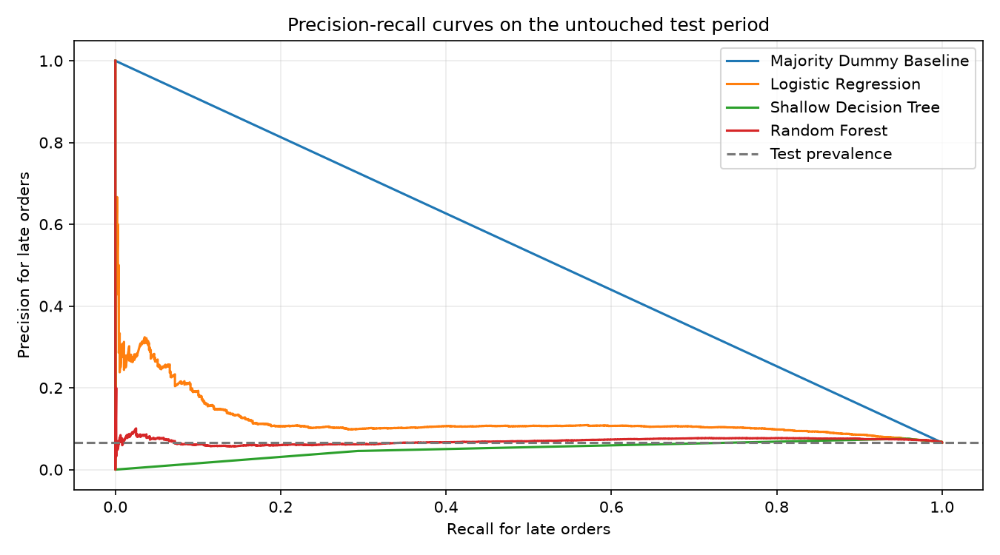
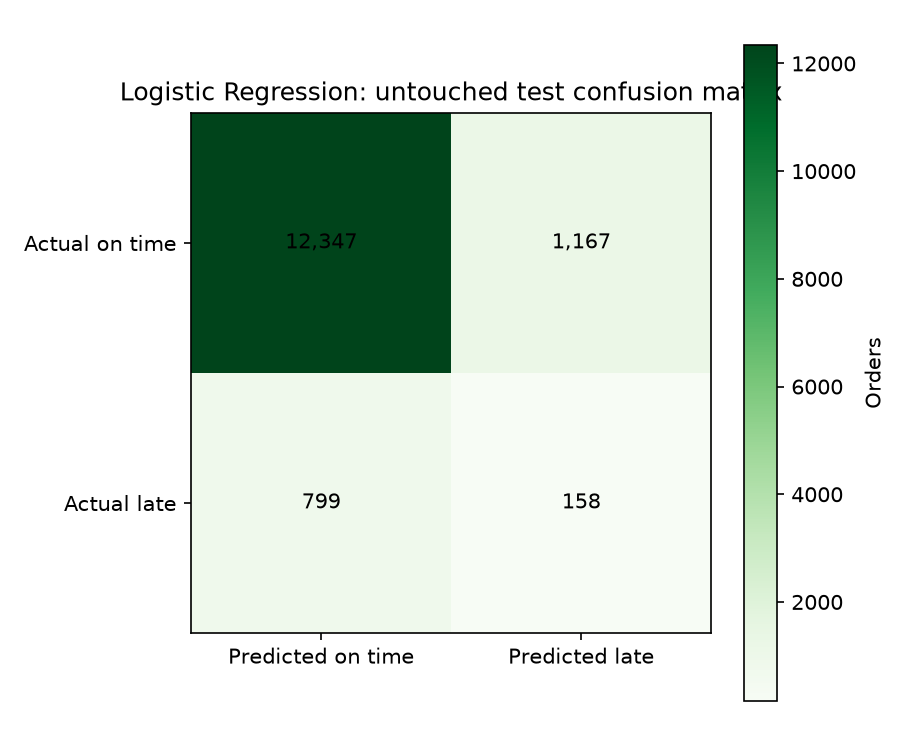

# Olist Late-Delivery Model Training — Phase 1B

**Status:** Educational benchmark models trained and evaluated. Results are not production performance and are not connected to the SupplyShield application.

## Question and target

Predict whether an Olist order delivered to the customer was later than its estimated delivery date. Positive class `1` means late; `0` means on or before the estimate. The target is constructed from actual and estimated delivery timestamps. Only orders marked delivered with a valid order ID and valid timestamps are eligible; a valid purchase timestamp is additionally required for the chronological split.

## Dataset and point-in-time assumptions

This is a non-commercial educational benchmark under the dataset card's CC BY-NC-SA 4.0 license. It represents Brazilian e-commerce, not global freight or all disruption types. Scoring time is assumed to be order purchase/placement. The estimated date, item prices/freight, customer state, product catalog fields, and seller state are assumed to be available at that moment; these are dataset-based assumptions and must be verified before any live integration.

Excluded from predictors: actual delivery timestamp, order status, order/customer/product/seller IDs, carrier delivery timestamp, review fields, payment fields, and shipping-limit timestamp. IDs are retained only for joins/split audit. The estimated delivery timestamp is used to construct the target and its difference from purchase time (`promised_lead_days`) is used as a predictor only under the stated availability assumption.

Order-level features aggregate multiple items: item count, distinct seller count, totals for item price and freight, average product weight/dimensions, most frequent product category, and most frequent seller state. Ties in the modal categories use the alphabetically first value. Categorical variables are one-hot encoded; numeric missing values are imputed with training-set medians. Logistic Regression also standardizes numeric inputs. All preprocessing is fitted within each model pipeline using only the training partition.

## Temporal split

Split rule: Chronological order-level rows sorted by purchase timestamp then order_id; first 70% train, next 15% validation, final 15% test. Each order_id occurs once and belongs to one split.

| Partition | Orders | Late orders | Late rate | Purchase-time range |
|---|---:|---:|---:|---|
| Train | 67,529 | 6,096 | 9.03% | 2016-09-15T12:16:38+00:00 to 2018-04-15T20:12:35+00:00 |
| Validation | 14,470 | 773 | 5.34% | 2018-04-15T20:17:11+00:00 to 2018-06-21T08:29:29+00:00 |
| Test | 14,471 | 957 | 6.61% | 2018-06-21T08:41:07+00:00 to 2018-08-29T15:00:37+00:00 |

## Threshold and model-selection rule

For Logistic Regression, Decision Tree, and Random Forest, probability thresholds were selected on validation data by highest late-class F1, then recall, then precision. The threshold was frozen before test evaluation. The Dummy baseline always predicts the training majority class. The selected fitted model is chosen from the three trained models by the same validation F1/recall/precision ordering; the final test results are reported once for all candidates and were not used to choose the model or threshold.

## Test results

Precision, recall, and F1 refer to the late class. Average precision is the summary of the precision-recall curve. Brier scores are reported on uncalibrated scores, especially affected by class-weighted training; do not interpret these as calibrated probabilities.

| Model | Threshold | Accuracy | Late precision | Late recall | Late F1 | Average precision | ROC AUC | Brier (uncalibrated) | TP | FP | FN | TN |
|---|---:|---:|---:|---:|---:|---:|---:|---:|---:|---:|---:|---:|
| Majority Dummy Baseline | 0.5000 | 0.9339 | 0.0000 | 0.0000 | 0.0000 | 0.0661 | 0.5000 | 0.0661 | 0 | 0 | 957 | 13,514 |
| Logistic Regression | 0.5049 | 0.8641 | 0.1192 | 0.1651 | 0.1385 | 0.1201 | 0.6688 | 0.1237 | 158 | 1,167 | 799 | 12,347 |
| Shallow Decision Tree | 0.4509 | 0.5474 | 0.0457 | 0.2936 | 0.0790 | 0.0664 | 0.4769 | 0.1543 | 281 | 5,873 | 676 | 7,641 |
| Random Forest | 0.3998 | 0.8378 | 0.0618 | 0.1024 | 0.0771 | 0.0704 | 0.5431 | 0.1299 | 98 | 1,488 | 859 | 12,026 |

Selected model by validation rule: **Logistic Regression** (validation threshold `0.5049`).

## Important interpretation limits

- Olist's late-delivery target is narrower than SupplyShield's general disruption objective.
- The benchmark's historical time period and Brazilian e-commerce setting do not establish performance on current SupplyShield shipments.
- Temporal holdout reduces future-time leakage but does not prove generalization to new suppliers, regions, businesses, or freight modes.
- The model uses a documented assumption that the estimated delivery date and order-time aggregates are available when scoring. If that is false for a deployment, those features must be removed and the model retrained.
- Threshold selection reflects statistical F1/recall/precision only; no operational alert-capacity or cost target was provided.
- Probability outputs have not been calibrated. Do not display them as reliable risk probabilities in the dashboard.
- False-positive and false-negative review is still needed with a domain reviewer; no operational decision or app integration is enabled.
- Data is licensed CC BY-NC-SA 4.0 and this benchmark is for non-commercial educational use.

## Reproducibility

- Model version: `olist-late-delivery-educational-v1`.
- Random seed: `42`.
- Source ZIP SHA-256: `967e41e04fc306fe604e2a693f488995a8b41e5047418f8a5c8e4abd6deca784`.
- Python: `3.15.0`; pandas `3.1.0`; scikit-learn `1.9.1`; NumPy `2.5.4`; joblib `1.6.0`.
- Selected estimator and fitted preprocessing are saved locally at `ml/artifacts/olist-late-delivery-educational-v1.joblib`; that folder is Git-ignored.
- Detailed JSON metrics, split manifest, validation thresholds, feature allow-list, and top transformed-feature importances are in `ml/reports/model_evaluation.json`.
- No React, Express, MongoDB, SAP AI Core, or inference-service integration was performed in Phase 1B.
