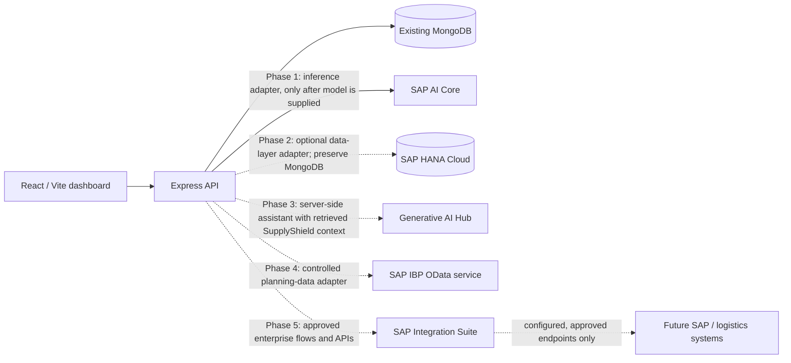

# SupplyShield Project Audit

**Audit date:** 2026-10-30  
**Scope:** Read-only review of the repository for the requested SAP integration. No application code was changed and no tests were run in this audit phase.

## 1. Existing architecture summary

SupplyShield is a browser-based operational-records dashboard served by a single Node.js application in production. During development, Vite serves the frontend separately and proxies `/api` calls to Express. Express persists operational records to MongoDB through Mongoose and serves the built frontend from `client/dist` after deployment.

The product includes shipment, inventory, supplier, return, and alert records, summary views, report export, and a local what-if calculator. When the database has no usable records, the frontend can show explicitly labeled synthetic demo data. The what-if view uses illustrative arithmetic. Neither feature is a machine-learning prediction.

The README and Model & data panel explicitly state that there is no dataset, trained model, prediction pipeline, or live logistics integration. Shipment risk and supplier scores are entered values. `spec.md` describes future ML requirements (Python/pandas/scikit-learn/joblib, Logistic Regression and Random Forest, preprocessing/evaluation contracts), but those are requirements only; corresponding code, manifests, data, and artifacts are absent. This is the primary blocker to the requested SAP AI Core model-serving objective: there is no existing trained model or preprocessing contract in this repository to package and reuse.

## 2. Current technology stack

| Area | Observed implementation |
|---|---|
| Frontend | React 18, TypeScript, Vite 6, Lucide React |
| Backend | Node.js ES modules, Express 4 |
| Database | MongoDB via Mongoose 8; MongoDB is the only configured persistent store |
| Machine learning | None present in source, dependencies, or repository file inventory; no model files or serialized model discovered |
| Prediction | None. Shipment `risk` and supplier reliability values are CRUD fields; UI calls them entered values |
| Data / demo | Manually entered MongoDB records plus five client-side synthetic sample records per operational category |
| Authentication | None in application routes or client flow. API CRUD endpoints are public. `.env` declares `AUTH_SECRET`, `ADMIN_EMAIL`, and `ADMIN_PASSWORD`, but current source does not consume them |
| Deployment | Render Blueprint; Node runtime; `npm ci --include=dev`, frontend build, `npm start`, `/api/health` check; `MONGODB_URI` configured as a secret Render environment variable |
| Tests | Node built-in test runner; `server/test/models.test.js` covers model helper functions. No frontend, API, DB integration, ML, or SAP tests are present |
| Existing SAP / external integrations | None detected |

## 3. Existing features and API

The Express API currently exposes:

- `GET /api/health` for server/database connection status.
- `GET /api/dashboard` for current shipments, active alerts, and inventory/supplier counts.
- CRUD routes for `/api/shipments`, `/api/inventory`, `/api/suppliers`, `/api/returns`, and `/api/alerts`.
- `PATCH /api/alerts/:id/acknowledge` for alert acknowledgement.

All non-health API routes are unavailable when MongoDB is disconnected. JSON request bodies are capped at 100 KB; route handlers perform allow-list checks and Mongoose schema validation. CORS allows the configured `CLIENT_ORIGIN` and credentials, but there is no API authentication or authorization. The frontend uses same-origin `fetch` calls.

Current Mongoose entities are `Shipment`, `InventoryItem`, `Supplier`, `ReturnRequest`, and `Alert`. There are no weather, disruption-event, or prediction-history entities.

## 4. Proposed SAP architecture

Integrate in the requested order and keep the current MongoDB application operating during the early phases. Do not claim a live SAP connection before credentials, service plans, tenant setup, and successful live checks exist.

### Dependency map and boundaries

1. **Existing UI → Express API → MongoDB** remains the current application path.
2. **Phase 1:** Express calls an AI Core serving endpoint through a backend-only adapter. The adapter cannot be implemented against a known model contract until the actual model, preprocessing, labels, and prediction input schema are provided. Existing manual risk values must remain distinct from model output.
3. **Phase 2:** HANA connectivity is added as an explicit data service. Existing MongoDB remains intact; a data ownership and migration decision is required before any cutover. The backend is Node.js, so the SAP HANA Node.js driver family is the applicable client family; select its precise package/runtime combination during implementation against the chosen BTP deployment target.
4. **Phase 3:** a backend assistant retrieves records through SupplyShield services, then calls SAP Generative AI Hub orchestration. Keep credentials server-side and label generated advice as advisory. User-visible facts must come from retrieved records.
5. **Phase 4:** an isolated IBP adapter maps only approved SupplyShield fields to tenant-configured planning objects/key figures. SAP documentation identifies `/IBP/PLANNING_DATA_API_SRV` for time-series key figures when integrating with external systems; actual planning-area configuration and tenant service availability must be confirmed before implementing live writes.
6. **Phase 5:** Integration Suite flows/API management provide enterprise integration boundaries. External endpoints and transformations must come from actual partner/SAP API specifications and tenant configuration.

The SAP-to-SAP interactions above are future intended paths, not current connectivity. No components, credentials, endpoints, or tenants are configured in this checkout.

## 5. Files likely to change and files to create

These are planning estimates; exact file boundaries should follow the existing code after each phase is approved.

| Phase | Likely existing files to modify | Likely new files |
|---|---|---|
| 1 — AI Core | `server/package.json`, `server/src/index.js`, potentially `client/src/App.tsx`, `client/src/data.ts`, `README.md`, `render.yaml`, `.env.example` | inference service/adapter and schemas under `server/src`; Docker and AI Core YAML/template files; `docs/AI_CORE_INTEGRATION.md`; `tests/sap-ai-core/` |
| 2 — HANA Cloud | `server/package.json`, `server/src/index.js`, potentially `server/src/models.js`, UI data services, deployment/environment docs | `database/` SQL scripts; HANA connection/repository modules; `docs/HANA_INTEGRATION.md`; `tests/sap-hana/` |
| 3 — Generative AI Hub | client app/navigation/styles, server routes/services, dependency/environment docs | assistant backend modules, `docs/GENERATIVE_AI_INTEGRATION.md`, `tests/generative-ai/` |
| 4 — IBP | server adapter registration and environment docs | IBP mapping/sync adapter, `docs/IBP_INTEGRATION.md`, `tests/sap-ibp/` |
| 5 — Integration Suite | server adapter registration and environment docs | integration-flow assets/specs as tenant requirements permit, `docs/INTEGRATION_SUITE.md`, `tests/integration-suite/` |
| 6 — Final review | deployment configuration and user-facing status surfaces as findings require | final architecture, deployment/user guides, final review report |

The four Phase 0 documents created by this audit are listed in the roadmap. No application code, deployment file, dependency manifest, or existing test was modified.

## 6. SAP accounts and services required

No SAP entitlements or tenant access can be verified from the repository. Expected access to confirm with the account owner:

- SAP BTP global account/subaccount with SAP AI Core entitlement, a service instance/key, and suitable registry/repository access for Phase 1. AI Core plan determines availability; SAP documentation distinguishes Free exploration, Standard production, and Extended production with Generative AI Hub.
- For Phase 2, an entitled SAP HANA Cloud instance, database user/schema privileges, network access from the selected application host, and securely provisioned connection credentials.
- For Phase 3, SAP AI Core Extended plan/Generative AI Hub entitlement, service instance credentials, and an available model/orchestration deployment.
- For Phase 4, an IBP tenant, planning area, configured communication arrangement and API permissions; service exposure and planning key figures must be confirmed with the IBP administrator.
- For Phase 5, an Integration Suite tenant and the specific activated capabilities (for example Cloud Integration or API Management), role assignments, and system-specific API specifications/credentials.

Never send service keys, passwords, tokens, private keys, or certificates in chat. Configure them in the chosen deployment platform's secret/environment-variable store.

## 7. Estimated implementation complexity

| Workstream | Relative complexity | Main reason |
|---|---|---|
| Phase 0 audit | Low | Source and configured stack are small and explicit |
| Phase 1 AI Core | High / currently blocked | No model artifact, training pipeline, feature contract, class mapping, or baseline inference test exists; SAP entitlement and deployment infrastructure are also unknown |
| Phase 2 HANA | High | Requires schema design and dual-store/data ownership strategy without disrupting MongoDB records; SAP tenant/network access unknown |
| Phase 3 GenAI Hub | Medium-high | Requires grounded retrieval, server-side credentials, prompt/output handling, and Extended plan access |
| Phase 4 IBP | High | Planning object/key-figure mapping and tenant configuration are business-specific; live data writes require explicit owner approval |
| Phase 5 Integration Suite | High | Flow design and security depend on actual external systems, APIs, and licensed capabilities |
| Final integration / production review | High | Includes security gaps, operational monitoring, performance, deployment, and cross-system validation |

Effort cannot be estimated reliably in hours until model availability, SAP access, target deployment environment, data ownership, and API contracts are known.

## 8. Compatibility and delivery risks

- **Model gap:** project context describes ML, but checked-in project does not contain it. Reuse/preserve existing preprocessing is impossible until its source and artifacts are located and reviewed. Do not invent an input schema or class mapping.
- **Authentication gap:** public write-capable APIs are not suitable for sensitive operational records on a public deployment. The unused auth-related environment variable names do not provide protection.
- **Hosting and network:** the current Render Node service must be able to reach SAP endpoints and HANA Cloud over supported secure network paths. Deployment plan is currently free-tier; suitability, egress/network policy, availability and cost need verification before production integration.
- **Database coexistence:** adopting HANA is not a reason to remove MongoDB. Records and the operational UI currently rely on MongoDB; migration or dual writes require an approved ownership and reconciliation plan.
- **Domain data gap:** current shipment records hold a free-text route and manually entered risk, but no normalized ports, modes, weather, fuel, geopolitical score, product/location identifiers, or confirmed disruption events.
- **Prediction history absent:** no stored prediction provenance, model version, features/evidence, or timestamped inference history exists.
- **Credentials:** no SAP environment variables, service key, or SAP SDK/client is configured. `.env` is ignored by Git; only its variable names were inspected.
- **Tests:** current tests cover model helper calculations only, not routes or connected services. No tests were run during this audit.

## 9. Testing strategy for later approved phases

Use the existing Node test runner and add focused suites per approved phase. Keep tests deterministic and separate mocked service tests from live tenant checks.

1. **Baseline/regression:** run the existing server tests and frontend production build; add API route tests for request validation, error responses, and unchanged CRUD behavior.
2. **AI Core:** unit-test model input preprocessing and output/class mapping against the supplied existing pipeline; mock auth/deployment/inference failures; compare local and AI Core predictions on a fixed approved fixture set with documented tolerances before enabling any traffic. Live auth and deployment checks require tenant access.
3. **HANA:** validate DDL and repository CRUD/transaction/error behavior against a test schema; test migration with a small fixture and verify record counts/field integrity. Preserve and test MongoDB behavior until separately approved migration.
4. **Generative AI Hub:** test retrieval/context construction, record provenance, refusal/error handling, and mock orchestration responses; live auth/model tests require the entitled tenant. Never treat model-generated wording as confirmed event data.
5. **IBP:** unit-test mappings and validation; mock OData paging/errors/auth; use read-only or sandbox tenant checks first. Do not create or update planning data without approval.
6. **Integration Suite:** validate transformation and retry/error behavior with mock endpoints and flow artifacts; test tenant connectivity only after tenant access is provided.
7. **Each phase:** run the relevant focused suite plus regression/build checks, report exact commands/results, and stop at the phase review gate.

## Sources checked

- [SAP AI Core — AI API Overview](https://help.sap.com/docs/sap-ai-core/sap-ai-core-service-guide/716d4c38e3054c93a9d481b51cc66298.html)
- [SAP AI Core — Use a Service Key](https://help.sap.com/docs/ai-core/ai-core/use-service-key)
- [SAP AI Core — service plan details](https://help.sap.com/doc/c31b38b32a5d4e07a4488cb0f8bb55d9/CLOUD/en-US/f17fa8568d0448c685f2a0301061a6ee.pdf)
- [SAP HANA Cloud — connect to SAP HANA Database](https://help.sap.com/docs/hana-cloud/sap-hana-cloud-getting-started-guide/connecting-to-sap-hana-database-in-sap-hana-cloud)
- [SAP HANA Cloud — standard SAP Node.js packages](https://help.sap.com/docs/HANA_CLOUD_DATABASE/b9902c314aef4afb8f7a29bf8c5b37b3/54513272339246049bf438a03a8095e4.html)
- [SAP Generative AI Hub — Quick Start](https://help.sap.com/docs/sap-ai-core/sap-ai-core-service-guide/ef03b580fd5c4bc3ac60843303df1322.html)
- [SAP IBP — Integrating Data with External Systems](https://help.sap.com/docs/SAP_INTEGRATED_BUSINESS_PLANNING/feae3cea3cc549aaa9d9de7d363a83e6/70b9672ba1524f179f2829815a82f03a.html)
- [SAP Integration Suite — What is SAP Integration Suite](https://help.sap.com/docs/integration-suite/sap-integration-suite/configuration-guide)
- [SAP Integration Suite — OData API](https://help.sap.com/docs/cloud-integration/sap-cloud-integration/odata-api)
