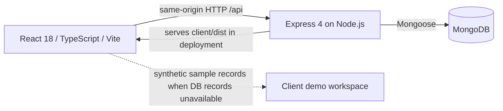
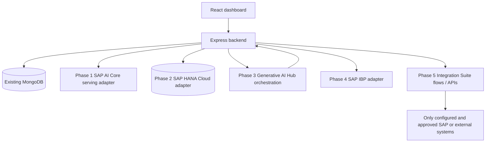

# SupplyShield SAP Integration Architecture

**Status:** Proposed only. No SAP tenant or connection is configured. The design follows the requested phase order and preserves the current application until an explicit data migration decision.

## Current system boundary

The current system has no ML service, SAP client, authentication middleware, or external logistics connector. Risk values are manually entered. Current operational persistence is MongoDB.

## Target architecture by phase

Arrows are intended paths after implementation, not evidence of current connectivity. Add adapters behind backend interfaces; do not expose credentials to React. Report the status from actual configuration and connectivity checks, with distinct states for pending setup, mock mode, failure, and live connection.

## Phase boundaries and data flow

### Phase 1 — SAP AI Core

SupplyShield backend → AI Core deployed model endpoint → structured model result → backend response/UI. Package the existing model and exact preprocessing only after locating and verifying them. Store prediction provenance separately from manually entered `Shipment.risk`. Retain the current path as fallback until comparison tests pass.

**Entry blocker:** this checkout contains no trained model, preprocessing implementation, feature order, class labels, or baseline inference output. AI Core service plan, service key, registry/repository, and target networking are also unverified.

### Phase 2 — SAP HANA Cloud

Backend HANA adapter is introduced beside MongoDB. Define which system owns each record type and how identifiers, writes, and historical records are reconciled before directing any production reads/writes to HANA. HANA Cloud schema can include shipments, weather, confirmed disruption events, prediction history, and alerts only after the domain fields and provenance are defined.

SAP's Node.js client documentation lists the HANA Node.js driver and `@sap/hdbext`; implementation must select a currently supported package and deployment/runtime configuration after checking the target platform. No database replacement or automatic migration is proposed.

### Phase 3 — SAP Generative AI Hub

Assistant request → backend retrieves relevant records via SupplyShield API/services → backend calls Hub orchestration → answer returned with record-based grounding. Keep generated mitigation advice clearly advisory and require human approval for operational actions. Do not permit the assistant to fabricate shipments or claim predictions are confirmed events.

SAP documentation places Generative AI Hub in SAP AI Core and requires the Extended service plan for this capability. A Hub model/orchestration endpoint and service entitlement are not confirmed.

### Phase 4 — SAP IBP

Approved SupplyShield data → validated field/key-figure mapping → isolated IBP adapter → configured IBP OData service. SAP Help currently documents `/IBP/PLANNING_DATA_API_SRV` for time-series key figures exchanged with external systems; actual planning area, key figures, service availability, communication arrangement, and tenant permissions remain to be confirmed. Initial live verification should be read-only/sandbox where available. Do not create or update real planning data without approval.

### Phase 5 — SAP Integration Suite

Integration Suite flows/API management orchestrate only approved system-to-system paths. Obtain real partner API specifications, authentication requirements, schemas, and tenant-specific endpoints before configuring any adapter. Use mock tests until then; never substitute invented URLs for actual endpoints.

## Security and operations boundaries

- Store service credentials only in deployment secrets or an approved secret manager.
- Add API authentication/authorization before using public write endpoints with sensitive operational records.
- Redact credentials/tokens from logs. Keep request IDs, status, timing, integration status, and safe error categories for operational support.
- Bound network timeouts and retries; use idempotency for retryable writes where supported.
- Expose integration status only from configuration and verified health/deployment state. A missing credential is `PENDING CONFIGURATION`; a deliberate adapter stub is `MOCK MODE`; a failed check is `DISCONNECTED` or `DEPLOYMENT FAILED`.
- Keep generated answers, ML predictions, manually entered scores, simulated values, and confirmed disruption events distinguishable in the data model and UI.

## Official documentation consulted

- [AI Core AI API](https://help.sap.com/docs/sap-ai-core/sap-ai-core-service-guide/716d4c38e3054c93a9d481b51cc66298.html) and [service key authentication](https://help.sap.com/docs/ai-core/ai-core/use-service-key).
- [SAP HANA Cloud connectivity](https://help.sap.com/docs/hana-cloud/sap-hana-cloud-getting-started-guide/connecting-to-sap-hana-database-in-sap-hana-cloud) and [Node.js packages](https://help.sap.com/docs/HANA_CLOUD_DATABASE/b9902c314aef4afb8f7a29bf8c5b37b3/54513272339246049bf438a03a8095e4.html).
- [Generative AI Hub Quick Start and prerequisites](https://help.sap.com/docs/sap-ai-core/sap-ai-core-service-guide/ef03b580fd5c4bc3ac60843303df1322.html).
- [IBP external data integration](https://help.sap.com/docs/SAP_INTEGRATED_BUSINESS_PLANNING/feae3cea3cc549aaa9d9de7d363a83e6/70b9672ba1524f179f2829815a82f03a.html).
- [Integration Suite capabilities](https://help.sap.com/docs/integration-suite/sap-integration-suite/configuration-guide) and [Cloud Integration OData API](https://help.sap.com/docs/cloud-integration/sap-cloud-integration/odata-api).
