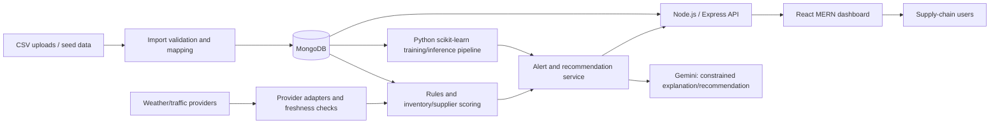

# SupplyShield — Spec-Driven Development Specification

**Document status:** Implementation contract  
**Product:** SupplyShield — Smart Supply Chain Disruption Detection System  
**Version:** 1.0  
**Date:** 2026-10-28  
**Application stack:** MERN (MongoDB, Express, React, Node.js)  
**AI integration:** Google Gemini API for grounded, human-readable recommendations and scenario explanations. Predictive risk classification remains based on Logistic Regression and Random Forest.

## 1. Overview

SupplyShield helps supply-chain teams detect shipment, inventory, supplier, weather, and transportation risks early enough to act. It combines transparent business rules, historical-data machine learning, inventory coverage calculations, supplier performance scoring, optional external context, and an interactive web dashboard. It is a decision-support product: users review evidence and choose actions; the system does not autonomously purchase, reroute, or change clinical care.

### Problem statement

Organizations often discover supply disruptions only after a delayed shipment or stockout becomes urgent. Relevant signals live in disconnected shipment, inventory, supplier, weather, and transport data. SupplyShield consolidates those signals, prioritizes risks, explains the evidence, and suggests practical actions. The illustrative use case is a hospital spotting a likely delay to a critical medicine while enough stock remains to arrange a substitute or expedite replenishment.

### Goals

- Detect late or at-risk shipments, projected low stock, and supplier performance issues.
- Train and compare Logistic Regression and Random Forest models for shipment disruption classification.
- Show a calibrated or clearly labeled disruption probability, model decision, evidence, and data freshness.
- Issue traceable, severity-ranked alerts with actionable guidance.
- Support weather and traffic context with explicit outage and stale-data behavior.
- Allow users to explore supplier failure, delivery delay, and demand-spike scenarios without changing live records.
- Provide a programmatic SupplyShield logo generator with in-memory PNG, SVG, and ICO downloads.
- Deliver a deployable MERN application with auditable data, security controls, and a repeatable demo.

### Non-goals

- Replacing an organization's ERP, procurement, warehouse, clinical, or transportation management systems.
- Automatically placing orders, approving suppliers, changing routes, or making patient-care decisions.
- Guaranteeing that a shipment will or will not be disrupted.
- Training a foundation model or using Gemini as the numeric disruption classifier.
- Treating synthetic data as evidence of production performance.
- Requiring Streamlit or any other separate dashboard/web framework. The user-selected web stack is MERN.

## 2. Users and use cases

| Persona | Needs | Typical use |
|---|---|---|
| Supply-chain manager | Prioritized, explainable risks and recommended actions | Review a high-risk shipment and coordinate an alternate route or supplier |
| Inventory planner | Days-of-cover and shortage forecasts | Identify stock likely to run out before replenishment arrives |
| Supplier relationship analyst | Comparable, evidence-based supplier performance | Find suppliers with repeated late, incomplete, or failed deliveries |
| Operations lead | Fleet-wide status, alerts, and trend visibility | Monitor shipment, inventory, and alert summaries during a disruption |
| Demo/evaluator | Understand the value and limitations quickly | Run seeded scenarios and inspect model metrics and recommendations |

### User stories

- As a supply-chain manager, I can see which shipments are most likely to be disrupted, why, and by when I need to act.
- As a hospital inventory planner, I can identify a critical medicine whose projected stock will fall below its safety level before the next delivery.
- As a supplier analyst, I can compare supplier reliability using delivery history and see the data supporting each score.
- As an operations lead, I can acknowledge and resolve alerts while preserving an audit trail.
- As a planner, I can simulate a supplier failure, delay, or demand spike and compare projected outcomes without modifying live data.
- As a user, I can generate and download a branded logo without external image-generation services or server-side file writes.

## 3. Scope and product boundaries

The first release supports CSV import and seeded demonstration data, normalized operational records in MongoDB, a scheduled/on-demand Python ML training workflow, a Node/Express API, and a React dashboard. Python is permitted for data preparation and model training/inference as a separately invoked service or batch process; it is not a web framework. The application API and UI remain MERN. Gemini calls are made from the server only, with limited, non-sensitive context and structured output validation.

All suggested schema fields and column names in this document are **proposed**. Implementations must map source data to these fields through a documented import mapping rather than claiming these names exist in a supplied dataset.

## 4. Functional requirements

Priority definitions: **P0** required for a usable MVP; **P1** required for the complete prototype; **P2** optional enhancement after acceptance.

### FR-01 — Disruption taxonomy and operational records (P0)

System must represent shipment disruption, late delivery, inventory shortage, supplier performance issue, weather risk, traffic/transit risk, and data-quality concern as distinguishable signals.

**Acceptance criteria**
- A shipment can be in planned, in-transit, delayed, delivered, cancelled, or unknown status.
- Rule-based flags and model predictions are stored/displayed separately and include their source, timestamp, and relevant evidence.
- An unknown or missing value is never silently represented as a safe/low-risk value.

### FR-02 — Dataset ingestion and validation (P0)

System must accept mapped CSV input for shipments, inventory, and supplier history; validate required fields and types; report row-level errors; and allow valid rows to be imported without hiding rejected rows.

**Acceptance criteria**
- Preview shows mapped columns, row count, validation errors, and a sample before import.
- Import is idempotent using a stable source identifier or documented composite key.
- Invalid dates, impossible quantities, duplicate identifiers, and unmapped columns are surfaced in an import report.
- Demo mode works with clearly labeled synthetic seed data when no user dataset is present.

### FR-03 — Shipment disruption detection (P0)

System must identify overdue shipments by comparing actual/current time with expected delivery and identify risk from configurable rules and the selected ML model.

**Acceptance criteria**
- An undelivered shipment past its expected arrival is flagged as late.
- A future shipment with a probability at/above the configured high threshold is flagged high risk.
- Each result shows shipment identifier, origin/destination, carrier, expected arrival, risk level, probability when available, top evidence, and last updated time.

### FR-04 — Inventory monitoring and shortage projection (P0)

System must track on-hand, reserved, inbound, average demand, lead time, and safety stock where available. Calculate usable stock and projected days of cover, and flag a shortage when projected inventory reaches the configured safety threshold before replenishment.

**Acceptance criteria**
- Displayed days of cover is `max(0, on_hand - reserved) / daily_demand`; zero or unavailable demand is explicitly marked as not calculable.
- Inbound quantity is only counted on or after its expected receipt date.
- A shortage alert is raised if projected available stock falls below safety stock before the next confirmed replenishment.
- Criticality is a user-provided business field and is not inferred from product names.

### FR-05 — Supplier risk analysis (P0)

System must calculate a transparent supplier score from delivery reliability, delay rate, quality/fulfillment issue rate, and sample size. Scores must show component values and observation window.

**Acceptance criteria**
- Score is within 0–100, with 100 meaning lower measured risk.
- A supplier with insufficient history is labeled “insufficient data”; the score is not treated as reliable.
- Users can inspect the underlying counts, dates, and rate calculations.

### FR-06 — ML training, evaluation, and inference (P0)

Train Logistic Regression and Random Forest classifiers using historical labeled shipment outcomes. Compare on a held-out test set using accuracy, precision, recall, and F1. Select according to the explicit selection rule in Section 8 and expose probability only if the model supports it.

**Acceptance criteria**
- Preprocessing is fitted only on training data and applied unchanged to validation/test/inference data.
- Test set is held out before model comparison; where dates exist, use a time-aware split to reduce leakage.
- Both model metrics, class distribution, split method, training data version, and selected model are recorded.
- Prediction returns disruption class, probability, model version, and timestamp. If model artifacts are missing or invalid, UI clearly falls back to rules and marks ML unavailable.

### FR-07 — Early-warning alerts (P0)

Create alerts for high-risk shipments, late shipments, projected stock shortages, high supplier risk, and degraded/stale external data when configured. Alerts include severity, entity, reason, evidence, suggested action, creation time, and lifecycle state.

**Acceptance criteria**
- Alert state supports open, acknowledged, resolved, and dismissed; state changes are attributed to a user and timestamped.
- Repeated evaluations update or deduplicate an active alert for the same entity/rule rather than creating unbounded duplicates.
- The dashboard supports severity and state filtering; no alert is silently deleted by acknowledgement.

### FR-08 — Weather and traffic context (P1)

Allow an adapter boundary for weather and traffic providers. Persist provider, observation/forecast time, route/location reference, and retrieval status. External data enriches risk context but does not overwrite source shipment facts.

**Acceptance criteria**
- Provider credentials are server-side environment secrets.
- If a provider is unavailable, times out, lacks coverage, or returns stale data, the system marks that source unavailable/stale and continues using operational data and rules.
- Provider-specific fields are mapped into a normalized internal context; raw payload retention is configurable and minimized.
- External data absence cannot lower an existing risk score or be interpreted as normal weather/traffic.

### FR-09 — Recommendations with Gemini and deterministic fallback (P1)

Gemini may generate concise explanations and action suggestions from a constrained, redacted evidence bundle. Recommendations for alternate suppliers/routes/replenishment must be grounded in available structured records and clearly labeled as suggestions. Deterministic templates/rules must provide a fallback.

**Acceptance criteria**
- Gemini is called only server-side; API keys never reach the browser or logs.
- Prompt input excludes personal/sensitive data and includes only relevant shipment, inventory, supplier, and normalized context fields.
- Model output is parsed against a schema (summary, evidence references, proposed actions, uncertainty); invalid or unsupported output is rejected and replaced by fallback text.
- Recommendations disclose when no qualified alternative supplier/route is present in the data and do not fabricate entities, prices, capacity, or lead times.
- Users retain control; no recommendation triggers a transaction.

### FR-10 — What-if simulation (P1)

Provide non-persistent scenario inputs for supplier failure, delivery delay, and demand increase. Recalculate projected arrival, inventory coverage, shortage timing, affected shipments, and risk indicators using deterministic logic and available model inference where valid.

**Acceptance criteria**
- Scenario inputs have documented units and bounds; invalid values are rejected.
- Results are clearly labeled simulated and do not mutate production records or create live alerts.
- Before/after results include assumptions, affected entities, and limitations.
- A scenario can be reset without persistence; optional saved scenarios are explicitly marked as user-created snapshots.

### FR-11 — Interactive dashboard (P0)

React UI must show operational summary, shipment table, inventory watchlist, supplier analysis, alerts, model performance, and detail views. Provide filters and a clear path from summary to evidence.

**Acceptance criteria**
- Summary counts respect the active date/filter scope and link to filtered detail lists.
- Tables provide search, sorting, pagination, and visible empty/error/loading states.
- Risk colors are accompanied by text labels and do not rely on color alone.
- Probability, rule score, supplier score, and inventory coverage are labeled as distinct measures.

### FR-12 — Logo / Branding tool (P1)

Allow the user to generate a simple SupplyShield logo programmatically in memory using Python-compatible SVG or browser/server-side SVG rendering. User options include app-name text, color theme, and style (e.g., shield, supply-chain motif). Preview and offer PNG, SVG, and ICO/favicon downloads. No external image-generation API is required.

**Acceptance criteria**
- The logo can be previewed and downloaded in all three formats without writing generated files to the server filesystem.
- PNG and ICO conversion uses a pinned, documented image library; SVG is valid and sanitized before display/download.
- Generated logo is shown in the React header/sidebar and used as the favicon/page icon.
- Logo generation failure shows an actionable error and retains the default brand asset.
- Downloaded assets open successfully and reflect selected text/theme/style.

### FR-13 — Auditability and configuration (P0)

Record imports, model versions, alert state changes, scenario metadata (if saved), and relevant administrative configuration changes. Thresholds and provider settings must be configurable without source edits.

**Acceptance criteria**
- Audit entries include actor, action, timestamp, and entity reference; secrets and full sensitive records are excluded.
- Threshold configuration is validated, versioned, and visible to authorized users.
- Changes do not retroactively rewrite the original evidence snapshot attached to a past alert.

## 5. Business rules, scoring, and thresholds

Thresholds below are **proposed defaults** for an initial demo. They must be configurable and reviewed against the organization's service levels before operational use.

| Measure | Proposed default | Rule |
|---|---:|---|
| Low/medium boundary | ML probability < 0.35 | Low, unless a stronger deterministic critical rule applies |
| Medium/high boundary | ML probability ≥ 0.65 | High; medium is 0.35–<0.65 |
| Overdue shipment | Current time > expected arrival and not delivered/cancelled | Late flag regardless of ML probability |
| High-delay rule | Delay ≥ 24 hours | High severity for critical shipments; otherwise medium pending policy |
| Inventory warning | Projected stock below safety stock within lead time + buffer | Medium by default |
| Inventory critical | Projected stockout within 7 days, or already below safety stock | High |
| Supplier attention | Supplier reliability score < 70 | Medium; <50 is high, subject to minimum sample size |
| Minimum supplier sample | 10 completed orders (proposed) | Below minimum, mark insufficient data |
| Weather/traffic freshness | Provider-specific; default max age 6 hours (proposed) | Older data is stale and not considered reassuring |

Rules do not imply medical urgency. Users configure business criticality and escalation policies. If multiple risk sources disagree, display them separately and raise the highest applicable alert severity with the reason stated.

### Supplier score method (proposed)

Use a 0–100 reliability score where higher is better. Proposed formula: `100 × (0.50 × on_time_rate + 0.25 × fulfillment_success_rate + 0.25 × quality_pass_rate)`. Each component is in [0,1]. If quality or fulfillment data is absent, renormalize over available weights and disclose the formula used. Apply minimum sample rules and show numerator, denominator, and date range. Do not rank suppliers with insufficient evidence as if scores were comparable.

### Inventory projection method (proposed)

For day `t`, projected available units = usable current stock − cumulative demand through `t` + confirmed inbound quantity whose receipt date is ≤ `t`. A shortage occurs on the earliest day projected stock falls below safety stock. Use trailing average demand only when actual demand history is available; disclose window and seasonality limitations. In the MVP, no replenishment optimization is implied.

## 6. Proposed data schemas

Every column name in the following tables is **proposed**, including identifiers. Map source-specific names at import time. Store normalized dates in UTC and quantities with explicit units.

### Proposed shipments dataset / MongoDB document

| Proposed field | Type | Required | Meaning |
|---|---|---:|---|
| `shipment_id` | string | Yes | Stable external or generated identifier |
| `supplier_id` | string | Yes | Supplier reference |
| `carrier_id` | string | No | Carrier reference |
| `origin_port` / `destination_port` | string | No | Origin and destination port/location labels |
| `transport_mode` | enum/string | No | Air, sea, road, rail, multimodal, or source value |
| `planned_departure_at` | datetime | No | Planned departure |
| `actual_departure_at` | datetime | No | Actual departure |
| `expected_arrival_at` | datetime | Yes | Current promised/expected arrival |
| `actual_arrival_at` | datetime | No | Actual delivery arrival |
| `shipment_status` | enum/string | Yes | Operational status |
| `quantity` | number | No | Shipped quantity and separately defined unit |
| `weather_condition` | string | No | Historical/observed condition if supplied |
| `fuel_price` | number | No | Price plus currency and effective date metadata |
| `geopolitical_risk_score` | number | No | Source score and documented scale |
| `carrier_reliability` | number | No | Source metric and documented scale |
| `disruption_label` | boolean/integer | Training only | Target: experienced qualifying disruption |
| `disruption_type` | string | No | Delay, cancellation, loss, damage, or source category |
| `source_updated_at` | datetime | No | Source freshness timestamp |

### Proposed inventory dataset / document

| Proposed field | Type | Required | Meaning |
|---|---|---:|---|
| `inventory_id` | string | Yes | Stable inventory record identifier |
| `item_id` | string | Yes | SKU/product reference |
| `item_name` | string | No | Display name |
| `location_id` | string | Yes | Warehouse/facility reference |
| `on_hand_quantity` | number | Yes | Physical on-hand units |
| `reserved_quantity` | number | No | Committed units, default 0 only if source semantics confirm |
| `safety_stock_quantity` | number | No | Business-defined reserve level |
| `average_daily_demand` | number | No | Derived/imported units per day |
| `demand_history` | array of dated quantities | No | Source for demand calculation |
| `unit_of_measure` | string | Yes | Units, packs, doses, etc. |
| `criticality` | enum/string | No | User/business assigned category |
| `next_replenishment_at` | datetime | No | Expected receipt date |
| `inbound_quantity` | number | No | Confirmed inbound units |
| `supplier_id` | string | No | Preferred supplier reference |

### Proposed supplier performance dataset / document

| Proposed field | Type | Required | Meaning |
|---|---|---:|---|
| `supplier_id` | string | Yes | Stable supplier reference |
| `supplier_name` | string | Yes | Display name |
| `order_id` | string | No | Order reference for event-level history |
| `order_date` | datetime | No | Order placement date |
| `promised_delivery_at` | datetime | No | Promised date |
| `delivered_at` | datetime | No | Actual delivery date |
| `order_status` | string | No | Completed, cancelled, etc. |
| `quantity_ordered` / `quantity_received` | number | No | Fulfillment measures |
| `quality_issue` | boolean | No | Quality failure indicator if recorded |
| `carrier_reliability` | number | No | Optional carrier measure; not automatically supplier measure |
| `performance_observed_at` | datetime | No | Record date/freshness |

### Data quality requirements

- Preserve original input and normalized value where feasible; retain source filename, import time, and mapping version.
- Validate numeric ranges against documented source scales; never assume a geopolitical or reliability score's scale.
- Missing values remain missing until imputation is fitted on training data. Include missingness indicators where useful.
- Label definitions must be documented, especially what constitutes “disruption” and the prediction horizon.
- Synthetic data must be labeled at dataset and UI levels and must not be combined invisibly with real data.
- Prevent target leakage: exclude post-outcome fields, actual arrival data unavailable at prediction time, and labels from model features.

## 7. Preprocessing and feature engineering

1. Validate schema, units, dates, IDs, label definition, duplicates, impossible values, and source freshness; produce a data-quality report.
2. Separate target and prediction-time features before transformation. Exclude identifiers unless a justified, leakage-safe derived feature is used.
3. Split by time where timestamps permit; otherwise use stratified train/test split with a fixed recorded seed. Keep all rows from a shipment/group in one split.
4. Fit numeric imputation (median baseline), categorical imputation (most frequent or explicit unknown), one-hot encoding with unseen-category handling, and scaling on training data only. Use `StandardScaler` for Logistic Regression; scaling is optional for Random Forest but a shared pipeline may include it if evaluation is consistent.
5. Handle class imbalance only within training data (class weights as initial approach); do not resample before splitting.
6. Record feature list, transformations, label mapping, split timestamps/IDs, and library versions alongside the model artifact.
7. Evaluate missingness, class distribution, and metrics by relevant groups where sample size allows (transport mode, route, supplier, and time period).
8. Reject inference records missing required inputs; otherwise use the saved pipeline's imputation and flag degraded input quality.

## 8. ML model and evaluation contract

### Required estimators and starting configuration

| Model | Proposed starting configuration |
|---|---|
| Logistic Regression | `max_iter=1000`, `class_weight="balanced"`, fixed random seed, numeric scaling and one-hot encoding in a fitted preprocessing pipeline |
| Random Forest | `n_estimators=300`, `max_depth=None`, `min_samples_leaf=2`, `class_weight="balanced_subsample"`, fixed random seed |

These are starting values, not guarantees of optimality. Tune only with training/validation data; keep the final test set untouched until model selection is frozen.

### Metrics and selection

- Report accuracy, precision, recall, and F1 on the same held-out test set; define disruption as the positive class.
- Include confusion matrix and positive-class prevalence. Because missed disruptions can be costly, use positive-class F1 as the default selection metric; break ties using recall, then precision, with operational review of false-positive burden.
- Do not select solely by accuracy where classes are imbalanced.
- If neither model has acceptable recall or the labeled dataset is too small, mark ML as experimental and rely on transparent rules; do not claim production readiness.
- Probability thresholds are configurable and distinct from classifier's default class threshold. If probability calibration is used, fit calibration on validation data, never the final test set.
- Persist metrics, model artifact, preprocessing artifact, data version/hash, selected threshold, training time, and software versions. Never retrain silently in a user session.

### Gemini boundary

Gemini is for natural-language explanation and recommendation drafting only. It does not supply the disruption label or risk probability. Risk probabilities come from the selected scikit-learn pipeline; rules and inventory formulas remain deterministic. Cache only safe, non-sensitive responses where justified, and preserve the evidence used to generate recommendations.

## 9. Alerts and recommendations

### Severity and alert content

| Severity | Trigger examples | Required content |
|---|---|---|
| High | Risk probability ≥ configured high threshold; critical stockout within 7 days; critical shipment overdue; supplier score <50 with adequate evidence | Entity, risk reason, probability/score if applicable, expected impact/time, evidence timestamp, suggested immediate review/action |
| Medium | Moderate risk; stock projected below safety stock within replenishment window; supplier score <70 | Reason, evidence, likely time horizon, monitoring or planning action |
| Low / informational | Non-urgent context such as stale provider data or a low risk trend | Source/status and follow-up needed |

Suggested action mapping (proposed): high shipment risk → confirm carrier status, assess alternate route/supplier, and review expediting options; shortage risk → verify demand and inbound date, then review replenishment or allocation; supplier risk → validate evidence and compare qualified alternatives; weather/traffic risk → check provider freshness and review route contingency. Gemini may improve concise wording but cannot invent actions unsupported by records.

## 10. External integration and fallback contract

Create provider interfaces behind server-side adapters; select actual vendors during implementation based on licensing, geography, rate limits, and credentials. Do not hard-code one provider into domain logic. Normalize response to route/location context, hazard/condition, observed/forecast time, provider status, and source reference.

- Apply timeout, bounded retry with backoff, rate limiting, and circuit-breaker behavior.
- Cache forecasts only within provider terms and configured freshness duration.
- On failure, show “Unavailable” or “Stale,” last successful retrieval, and provider error category; continue core dashboard and deterministic risk logic.
- Do not use public demo endpoints or scrape websites as a production dependency.
- Store credentials in deployment secrets; redact them from errors and audit logs.

## 11. What-if simulation

| Scenario | Inputs | Outputs |
|---|---|---|
| Supplier failure | Supplier, affected items/shipments, assumed disruption duration, optional substitute supplier | Affected stock, uncovered demand, shortage date, alternative coverage if known |
| Delivery delay | Shipment(s), added delay in hours/days | Revised arrival, stock coverage, potential shortage date, changed risk indicators |
| Demand increase | Item/location, percentage or units/day, duration | Revised coverage, stockout date, replenishment gap |

Simulation uses a snapshot of current known data, displays snapshot time and assumptions, and runs read-only calculations. It must not emit operational alerts or change MongoDB records. The interface must distinguish model outputs from scenario arithmetic.

## 12. MERN application UI contract

### Pages

1. **Overview:** KPI cards, risk distribution, trend, active high-priority alerts, data freshness, and links to detail.
2. **Shipments:** searchable/filterable table, risk/probability, status, dates, carrier, evidence and detail drawer/page.
3. **Inventory:** on-hand, safety stock, days of cover, inbound, projected shortage date, item/location filters.
4. **Suppliers:** reliability score, component rates, sample size, trend, and supplier detail.
5. **Alerts:** severity/state/entity filters, acknowledge/resolve/dismiss actions, evidence and audit history.
6. **What-if:** scenario selector and bounded inputs; side-by-side baseline/simulated outcomes.
7. **Model & Data:** import/validation report, dataset provenance, model metrics/version and ML availability.
8. **Logo / Branding:** options, preview, download controls, and help text explaining generated files are in-memory.

### Shared UI behavior

- Persistent navigation and responsive layout for desktop/tablet; support keyboard navigation and accessible labels.
- Every data view has loading, empty, stale, permission-denied, and error states.
- Use text and icon labels with risk colors; provide date/time in user's locale with source timestamps available.
- Filters include date range, supplier, transport mode, status, severity, and location as appropriate.
- The header/sidebar use generated or default logo; favicon uses the current default brand asset. If dynamically changing browser favicon is unsupported in the chosen deployment setup, retain the default static favicon and explicitly document this limitation while still allowing downloads.

## 13. System architecture and data flow



### Components and boundaries

- **React client:** presentation, filtering, user interaction, input validation for usability. No provider or Gemini secrets.
- **Node.js/Express API:** authentication/authorization boundary, request validation, domain orchestration, Gemini calls, audit writes, and MongoDB access.
- **MongoDB:** operational records, normalized imports, alerts, configuration, audit metadata, and model registry metadata. Large model binaries may use deployment artifact storage; MongoDB stores references and hashes.
- **Python ML package/process:** reproducible preprocessing, training, evaluation, and inference for required scikit-learn models. It may be a batch process or a separately deployed internal service; do not introduce Flask or another web framework. If synchronous inference is needed, use an internal worker/CLI boundary or a narrowly defined service using the existing Node API integration strategy.
- **External adapters:** provider-specific weather/traffic access, normalized responses, timeout/fallback behavior.
- **Gemini:** server-side generation of constrained prose only; output must be validated and tied to evidence references.

### API boundary (proposed REST contract)

Express routes are versioned under `/api/v1`. Minimum resource groups: `/shipments`, `/inventory`, `/suppliers`, `/alerts`, `/imports`, `/models`, `/scenarios`, `/recommendations`, `/branding`. Use JSON, schema validation, pagination, consistent error envelopes, request IDs, and role-based access. No browser-to-database access. Exact route payloads may be refined during implementation without changing requirement outcomes. Logo generation/download endpoints may return bytes with correct MIME type, or generate in the browser; neither path persists generated files.

## 14. Security, privacy, and governance

- Authenticate users for non-demo deployments; authorize read/write/import/configuration actions by role.
- Validate and sanitize uploaded files, enforce size/row limits, reject executable content, and guard against injection in UI rendering and database queries.
- Use TLS in transit, managed encryption at rest, least-privilege database credentials, and secret manager/environment configuration.
- Never expose Gemini, database, or weather/traffic credentials to the client. Redact secrets and sensitive payloads from logs.
- Minimize data sent to Gemini; do not send patient identifiers or personal data. For hospital scenarios, treat item/stock data as operationally sensitive and apply organization retention/access policy.
- Define retention and deletion rules for imported files, normalized records, audit events, and provider payloads before real deployment.
- Provide audit trail for imports, alert actions, model version changes, and configuration edits.
- Add rate limits and request validation to API endpoints; protect state-changing actions against CSRF where cookie auth is used.
- Show model/data limitations and require human review for high-impact decisions.

## 15. Non-functional requirements

| Area | Requirement |
|---|---|
| Performance | For demo-scale data (up to 10,000 shipments and 10,000 inventory rows), overview and filtered tables should load within 3 seconds at p95 on the target demo environment, excluding cold start and third-party latency. |
| Reliability | Core dashboard and deterministic rules continue when Gemini or external providers fail. Model unavailability degrades to rule-only results with explicit labeling. |
| Usability | Common workflow (find a high-risk item, inspect evidence, acknowledge alert) should be completable without documentation. Labels distinguish probability, score, and measured operational facts. |
| Accessibility | Target WCAG 2.1 AA for primary flows: keyboard access, visible focus, semantic labels, contrast, and non-color risk communication. |
| Security | No secrets in client bundle or repository; server validates all untrusted inputs; authorization enforced server-side. |
| Maintainability | Separate domain rules, provider adapters, API handlers, UI components, and ML pipeline; typed/validated API contracts and documented environment variables. |
| Reproducibility | Fixed seeds and versioned dataset/split/config for training; preserve model and preprocessing versions with metrics. |
| Observability | Structured logs, request IDs, health/readiness status, import failures, provider health, Gemini failures, and model version availability; exclude sensitive values. |
| Portability | Local development and target deployment use documented environment variables and repeatable setup; no generated logo filesystem dependency. |

## 16. Proposed project structure

```text
supplyshield/
  client/                         # React application
    src/
      app/ components/ features/ pages/ services/ styles/
      assets/                     # Static fallback logo/favicon only
  server/                         # Node.js + Express API
    src/
      config/ middleware/ routes/ controllers/ services/ models/ validators/
      integrations/               # Gemini, weather, traffic adapters
      tests/
  ml/                              # Python data/ML package (not a web app)
    src/supplyshield_ml/
      data/ features/ training/ inference/ evaluation/
    tests/ models/                 # generated artifacts excluded from git
  data/
    samples/                       # explicitly synthetic/demo data
    reports/                       # generated validation/metric reports
  docs/
    spec.md
  .env.example
  package.json                    # workspace scripts
  README.md
```

## 17. Technology and dependencies

### Required

- **MongoDB** for persisted application data.
- **Express + Node.js** for the API and server-side integrations.
- **React** for the dashboard UI.
- **Python, pandas, scikit-learn, joblib** for data preprocessing and the required classifiers.
- **Google Gemini API** through the official supported SDK/client selected during implementation; pin and document its version.
- CSV parsing/validation, schema validation, secure authentication, and charting libraries selected by the development team and pinned in lockfiles.
- Pillow (or equivalent pinned image library) for in-memory PNG/ICO generation when not using a pure SVG/browser conversion path.

### Dependency policy

Maintain separate client, server, and ML dependency manifests. Pin compatible versions, commit lockfiles, scan dependencies in CI, and document provider SDK changes. Do not add Flask or another web framework. Do not use Gemini as an excuse to omit or replace the specified Logistic Regression and Random Forest comparison.

## 18. Environment and deployment

- Local setup: install supported Node.js and Python versions, start MongoDB (local or container), install locked dependencies, copy `.env.example` to a private environment file, seed synthetic data, run API/client, and run the ML training command.
- Required configuration names (proposed): `MONGODB_URI`, `SESSION_SECRET` or auth-provider settings, `GEMINI_API_KEY`, `WEATHER_API_KEY`, `TRAFFIC_API_KEY`, `CLIENT_ORIGIN`, `MODEL_ARTIFACT_URI`, `APP_ENV`. Never commit real values.
- Deployment: deploy React static assets and Node/Express API to a supported hosting platform; use managed MongoDB and secret storage. Deploy ML artifact/worker in an environment compatible with Python dependencies. Streamlit Community Cloud is not applicable to this MERN architecture.
- Configure CORS narrowly, HTTPS, health checks, database backups, logs/monitoring, and environment-specific seeds.
- Demo deployment must clearly identify synthetic data and provide a no-provider mode.
- Post-deployment verification: login/role access, API health, sample data, model metrics/inference, external-provider fallback, Gemini fallback, logo preview and PNG/SVG/ICO downloads, header/sidebar branding, favicon behavior, and mobile/tablet layout.

## 19. Testing and validation strategy

Testing is required as part of delivery. Use appropriate unit, integration, UI, and end-to-end checks; avoid live third-party dependency in routine automated tests by using mocked adapters and deterministic fixtures.

- **Data tests:** schema mapping, duplicate handling, invalid values, missingness, units, idempotent import, synthetic-data labeling.
- **Rule tests:** late shipment, projected shortage, inbound timing, supplier score components, minimum sample handling, threshold boundaries, severity precedence.
- **ML tests:** train/test leakage checks, preprocessing consistency, unseen categories, metric computation, positive class mapping, artifact load, missing artifact fallback.
- **API tests:** authentication/authorization, validation, pagination, alert lifecycle/audit, error envelopes, rate limits, secret redaction.
- **Integration tests:** MongoDB repository flows, provider timeout/stale/no-coverage behavior, Gemini malformed/unsupported output fallback.
- **UI tests:** loading/error/empty states, filters, accessible risk labels, alert actions, scenario non-persistence, responsive layout.
- **Logo tests:** selected options reflected in generated output; valid PNG/SVG/ICO bytes and MIME types; no persistent file creation; default fallback on failure; header/sidebar/favicon verification.
- **End-to-end scenarios:** baseline; delayed high-risk shipment; critical medicine demand spike; supplier failure; weather/traffic outage; stale data; missing ML artifact; Gemini outage; low sample supplier; invalid import.
- **Model acceptance:** report test metrics and confusion matrix, inspect false negatives/positives with stakeholders, and document that demo metrics do not establish real-world performance.

## 20. Phased implementation plan (11 steps)

| Step | Phase | Deliverable / exit condition |
|---:|---|---|
| 1 | Define disruptions | Approved label definition, prediction horizon, rule taxonomy, and configurable thresholds documented. |
| 2 | Collect/create data | Source inventory and supplier history identified or synthetic datasets generated and clearly labeled; proposed schema mapping documented. |
| 3 | Clean/process data | Reproducible validation, cleaning, preprocessing report, leakage-safe split, and training-ready feature matrix. |
| 4 | Basic rules | Tested late-delivery, low-stock, and supplier-issue rules with clear evidence. |
| 5 | Train/evaluate ML | Logistic Regression and Random Forest evaluated on same held-out set; selection rule and model artifact recorded. |
| 6 | Build MERN dashboard | React UI, Express API, MongoDB persistence, core pages, filters, and loading/error states. |
| 7 | Add scores/alerts/recommendations | Risk display, alert lifecycle, deterministic actions, Gemini explanation path, and fallback behavior. |
| 8 | Implement simulation | Supplier failure, delivery delay, demand spike inputs and read-only before/after results. |
| 9 | Add logo feature | In-memory generation, preview, PNG/SVG/ICO downloads, app branding, favicon verification. |
| 10 | Test scenarios | Automated and manual scenario matrix passes; defects and limitations recorded. |
| 11 | Presentation/demo | Demo dataset, walkthrough, architecture/model summary, limitations, and deployment verification prepared. |

Phases may overlap when dependencies permit, but later work must not obscure incomplete acceptance conditions from earlier steps.

## 21. Demo and presentation plan

Demonstrate: (1) overview of seeded synthetic operation; (2) shipment with elevated disruption risk and inspected evidence; (3) hospital medicine inventory projected to fall below safety stock before expected replenishment; (4) supplier comparison with sample size; (5) alert acknowledgement; (6) one what-if delay or demand-spike scenario; (7) provider/Gemini outage fallback; (8) logo customization and three downloads. Explain model metrics, label limitations, synthetic data, and that recommendations require human review. Avoid presenting sample metrics as proof of production efficacy.

## 22. Risks, assumptions, and limitations

### Assumptions

- The user-selected application stack is MERN and the AI service is Gemini. The earlier Streamlit-only constraint is superseded by this stack change.
- Python remains acceptable for the specified scikit-learn ML pipeline and image conversion; it is not used as a web framework.
- No real dataset is guaranteed. A clearly labeled synthetic dataset may be created for development and demonstration.
- Organizations will provide disruption labels, criticality rules, inventory units, demand semantics, and operational thresholds before production use.
- Weather and traffic providers will be selected after geography, cost, licensing, and availability are known.
- Gemini is optional at runtime; deterministic recommendations must remain available.

### Risks and mitigations

| Risk | Mitigation |
|---|---|
| Sparse or biased disruption labels | Report class distribution, use time-aware evaluation, keep rules active, and label ML experimental until validated. |
| Leakage from post-outcome fields | Maintain prediction-time feature contract and automated leakage review. |
| Synthetic data mistaken for real performance | Persistent demo labeling and explicit presentation disclosure. |
| False negatives or alarm fatigue | Tune thresholds with users, display evidence/uncertainty, deduplicate alerts, and keep human review. |
| Stale/missing provider data | Freshness metadata, explicit fallback state, no “missing means safe” behavior. |
| Gemini hallucination or outage | Constrained context/output schema, evidence validation, deterministic fallback, no autonomous action. |
| Incompatible schema semantics/units | Import mapping and validation report; require unit and scale documentation. |
| Sensitive operational data exposure | Data minimization, access control, secret handling, retention policy, and redacted logs. |
| MERN/Python deployment complexity | Separate manifests and reproducible ML artifact interface; verify build/deploy contract early. |

### Limitations

Predictions depend on data coverage, label quality, and changing operating conditions. Supplier scores may be incomparable when sample sizes or definitions differ. Weather/traffic data may lack route coverage or freshness. Gemini output may be unavailable or unsuitable and must be reviewed. Inventory projections are simplified and do not replace planning systems.

## 23. Definition of Ready

A feature is ready to implement when its user outcome and requirement ID are understood; data inputs, units, and ownership are documented; acceptance criteria are testable; security/privacy implications are reviewed; and provider/API dependencies and fallback behavior are known or explicitly mocked.

## 24. Definition of Done

A feature is done when its acceptance criteria pass; relevant automated checks and scenario validation pass; loading, empty, error, and unavailable states are implemented; data/model/source provenance is visible where required; security and accessibility expectations are met; documentation and configuration examples are updated; and the change is demoable without relying on unavailable external services.

## 25. Final acceptance checklist

- [ ] MERN is the only application web stack; no Flask or Streamlit dashboard is introduced.
- [ ] React dashboard displays shipment, inventory, supplier, alert, model, and freshness information.
- [ ] CSV mapping/validation works for proposed shipment, inventory, and supplier schemas; all proposed column names are treated as suggestions.
- [ ] Rules identify late shipments, low stock, and supplier issues with configurable thresholds.
- [ ] Logistic Regression and Random Forest train and compare on a leakage-safe held-out dataset using accuracy, precision, recall, and F1.
- [ ] Model selection, limitations, version, probability, and rule-only fallback are visible and auditable.
- [ ] Inventory coverage and supplier scores expose formulas, evidence, and insufficient-data handling.
- [ ] Alerts have severity, evidence, deduplication, and an acknowledged/resolved lifecycle.
- [ ] Weather/traffic and Gemini failures fall back without breaking core workflows or implying safe conditions.
- [ ] Gemini generates only constrained, validated explanatory/recommendation text; no autonomous operations occur.
- [ ] All three requested what-if scenarios run read-only and show assumptions and before/after results.
- [ ] Logo is generated in memory, previewed, downloaded as PNG/SVG/ICO, and displayed in the app branding.
- [ ] Security, privacy, API, environment, dependency, deployment, and rollback/configuration expectations are documented.
- [ ] Automated checks and the scenario matrix pass; synthetic data and demo limitations are clearly labeled.
- [ ] The 11 implementation phases and demo/presentation deliverables are complete.

---

**Specification end.** Any implementation change that alters a requirement, threshold, schema mapping, model selection policy, or integration boundary should be recorded as an explicit spec revision and reviewed against this acceptance checklist.
